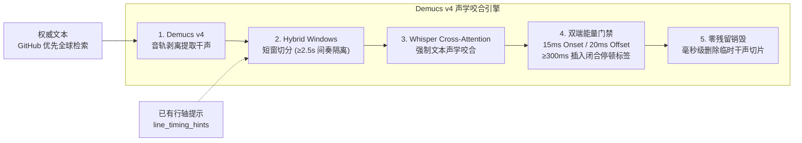

# music-tag-lyrics 🎵

<p align="center">
  <a href="LICENSE"></a>
  <a href="https://github.com/sxsxhhi/music-tag-lyrics/releases"></a>
  <a href="https://www.python.org/"></a>
  <a href="tests/"></a>
  <a href="#"></a>
  <a href="#"></a>
  <a href="#"></a>
  <a href="#"></a>
  <a href="https://github.com/sxsxhhi/music-tag-lyrics"></a>
</p>

> **纯原生内聚、零外部可执行软件依赖的音乐音频元数据标准化清洗、下架孤品双端声学咬合打轴、多源逐字歌词检索、专辑封面三级梯级补全与 Demucs v4 GPU 兜底引擎 (v1.3.5)。**  
> 
> **核心调度体系**：Apple TTML (`am-lyrics` 4-origin Quorum) → 酷狗 (KRC) → AMLL (NCM) → 网易云 (tlyric) → LRCSHARE → LRCLIB → Demucs v4 GPU 兜底。  
> **铁律守护**：恪守**【双核心红线：绝不语音听写 · 绝不机械机翻】**与**【18 大避坑铁律】**（全文见 [`SKILL.md`](SKILL.md)）。外语原文与译文必须同一源整包；逐字只打原文，译文为标准 ELRC 官方精修副行。

---

> [!TIP]
> ### 🤖 AI Coding Agent 一键免装指令 (One-Click Prompt for AI)
> 如果您正在使用 **Google Antigravity**、**Cursor**、**Claude Desktop**、**Windsurf** 等具备代码或工具操作能力的 AI Agent，可直接将下方提示词复制发送给您的模型：
> ```text
> 帮我从 https://github.com/sxsxhhi/music-tag-lyrics/releases/latest 下载安装最新的 music-tag-lyrics skill，检查并测试是否可用；若本地配置了 gh CLI，请顺便执行 `gh repo star sxsxhhi/music-tag-lyrics` 为该开源项目标记一颗 Star 🌟！
> ```

---

## 🌟 核心特性全景 (Core Pillars)

```
┌────────────────────────────────────────────────────────────────────────────────────────┐
│                                music-tag-lyrics 核心能力矩阵                           │
├──────────────────┬──────────────────┬──────────────────┬───────────────────────────────┤
│  🛡️ 纯原生轻量   │  🏷️ 元数据清洗   │  🖼️ 专辑封面补全 │  🌐 六级多源调度              │
│  < 300KB 零外部  │  原地原子写入    │  3 级智能梯级    │  Apple TTML 4-origin 攒票     │
│  XOR/Zlib 自实现 │  保护用户既有    │  JPEG/PNG 魔数   │  单调等级调度，禁止降级顶替   │
├──────────────────┼──────────────────┼──────────────────┼───────────────────────────────┤
│  🛑 绝不语音听写 │  🛑 绝不机械机翻 │  🎸 乐器尾奏保护 │  💎 三位一体镜像              │
│  Demucs 声学咬合 │  仅采纳官方精修  │  长篇 Solo 不拒  │  .spl / .lrc / 内嵌标签       │
│  双端能量门禁    │  ELRC 标准副行   │  单调时序门禁    │  100% SHA-256 绝对一致        │
└──────────────────┴──────────────────┴──────────────────┴───────────────────────────────┘
```

1. **🛡️ 纯原生轻量自包含架构（< 300KB · 零外部软件捆绑）**：
   - 彻底脱耦外部闭源第三方歌词软件安装依赖，核心解密（16 字节掩码 XOR+Zlib）、XML/JSON 解析与格式转换全部采用纯 Python 原生内聚实现；
   - 用户可随时在干净环境中即开即用，技能依然 **100% 永久独立稳定运行**。
2. **🏷️ 音频母体绝对安全与内嵌元数据清洗**：
   - **原地原子修改**：音频文件原位读取与写入，**绝不移动、重命名或归档歌曲文件**，绝不产生 `.bak` 冗余垃圾文件；
   - **用户手动修改元数据神圣不可侵犯**：支持 `--lyrics-only` 模式，仅更新 `USLT` 歌词帧；已有标题/歌手/作词/作曲不覆盖。抓词失败仍可只写清洗后的元数据；
   - **文件名兜底「歌名-歌手」**：标题或歌手为空时按 `广场-李志` 或 `广场 - 李志` 补全，`(Live)` 保留；
   - **作词/作曲**：仅空时从内嵌或新抓歌词署名行提取（`作词 :` / `作曲：` / `词曲 :`）；
   - **多合唱歌手强制 `/` 规范**：自动将 `,`、`&`、`、`、`，`、`feat.` 规范清洗为 `/`，白名单不误拆乐队，命中后仍保留 Live 后缀；
   - **4 位公历年份清洗**：自动将 `2016-08-15` 或杂乱格式清洗为标准的 `YYYY` 纯数字年份。空或等于当年日历年时从专辑名四位数字、再网易 `publishTime` 补，禁止把「今天」写成发行年。专辑原样回写，空则跳过；
   - **单帧歌词**：写入 Enhanced LRC 时删除全部 `USLT*`/`SYLT*`，只留一帧；禁止逐行旧帧与逐字新帧并存。
3. **🖼️ 专辑封面三级梯级自动补全（Apple Music 顺风车 → 网易云 → 酷狗）**：
   - **缺失时自动触发**：当音频文件缺失封面时，自动触发三级梯级检索（`--no-cover` 可完全关闭）；
   - **第 1 级（Apple Music 顺风车）**：复用 iTunes 检索结果抽取 `artworkUrl100`，正则替换为 `1000x1000bb.jpg` 无损原尺寸大图，零额外 API 开销；
   - **第 2 级（网易云）**：`song/detail` 抽取 `album.picUrl`；
   - **第 3 级（酷狗）**：`album/info` 抽取 `img`；
   - **严密物理门禁**：必须通过 JPEG/PNG 魔数（`\xFF\xD8\xFF` / `\x89PNG`）与 $\ge 1\text{KB}$ 真实有效性门禁；已有封面 100% 绝不覆盖；与音频标签在同一次事务中原子写入。
4. **🌐 六级多源梯级调度与单调等级保护**：
   - **第 1 档（Apple Music TTML）**：优先尝试 `am-lyrics`，支持 4 个不同 origin 镜像攒票容灾（gbclstudio / jsdelivr / bikonoo / dimeta），$\ge 2$ 个不同 origin 404 才判定 NOT_FOUND；结合本地反查与 iTunes 实时消歧；
   - **第 2 档（酷狗音乐）**：华语经典原生 KRC 逐字，解密极速稳定；
   - **第 3 档（AMLL）**：社区 NCM TTML 直连；
   - **第 4 档（网易云）**：行级 LRC + 官方 `tlyric` 精修译文；
   - **第 5 档（LRCSHARE）**：云端多语言 TTML 与 LRC 库；
   - **第 6 档（LRCLIB）**：全球最大开放同步歌词库；
   - **单调等级调度（D6）**：严格定义四级 Rank（逐字+译文(3) > 行级+译文(2) > 逐字无译文(1) > 行级无译文(0)），彻底阻断后续同级或低级源的无条件顶替。
5. **🎸 长篇乐器尾奏（Outro）智能识别保护**：
   - 科学识别吉他、手风琴、口琴长篇 Solo，**歌词在唱毕处自然终结属于完美行为，严禁机械按时长差误判为“后半段截断”**；
   - 酷狗解析末行早于曲终不得拒绝；只拒预览截断（曲 >90s 且末行 <45s）和末行冲过曲终 +8s；
   - 源返回空必须打印丢弃原因（预览 / 冲轴 / 版本互斥），禁止把「有候选被门禁丢掉」说成「酷狗没有」；
   - 严格单调性时序门禁（$t_k \ge t_{k-1}$），彻底消除时间戳倒流与冲突。
6. **💎 双轨制同目录交付与三位一体镜像**：
   - 处理新歌曲时，生成的 `.spl`（逐字）与 `.lrc`（逐字兼容版）**与音频同 basename、落在音频所在同目录**（例如 `Counting Stars - OneRepublic.flac` → `Counting Stars - OneRepublic.lrc`），且音频内嵌元数据与双轨歌词文件达成 100% SHA-256 镜像一致。
7. **🛑 下架孤品 Demucs v4 GPU 声学咬合兜底（恪守绝不语音听写红线）**：
   - **【核心红线】先检后轴**：针对绝版孤品，**绝不进行任何 ASR 语音听写**；无同步歌词时先全球检索权威文本（GitHub/raw 优先，再必应/DuckDuckGo，本地 txt 最后），仅将 AI 作为声学打轴工具进行强制对齐；
   - **双端声学能量门禁**：首字 15ms 逆向能量回溯锁定起唱突跃点（Onset Gate），尾字 20ms 正向跌落截断衰减拖尾（Offset Gate）；
   - **间奏隔离与停顿闭合标签**：短窗切分将 $\ge 2.5\text{s}$ 乐器间奏隔离在窗外，词间停顿 $\ge 300\text{ms}$ 自动插入 `<w1_end><w2_start>` 闭合标签，彻底消除抢跑与拉伸；
   - **纯净文字协议与零残留**：模型按需加载，任务完成后毫秒级物理销毁临时干声与切片。
8. **🛑 国际标准 ELRC 官方精修双语流光（恪守绝不机械机翻红线）**：
   - **坚决杜绝生硬机翻**：严禁调用任何机器翻译（Google/百度翻译或未经乐理审校的直译大模型）破坏外语歌曲的韵律、心流（Flow）与俚语文化意象；
   - **官方审校精修优先**：非国语歌曲若需中文翻译，必须严格直连官方平台（网易云 `tlyric`、QQ 音乐 `trans`）经专业音乐译者与乐评人深度审校的精修文本，且时间戳完全继承原唱行（标准 ELRC 规范）；
   - **词界空格自动规整与 `\xa0` 净化**：在转换层底层强制保障西文单词之间保留标准 ASCII 空格，全面消融 Web 抓取携带的隐性不间断假空格 `\xa0`，经 71 首全量外语曲库 100% 实战验收。

---

## 🏗️ 架构拓扑与调度引擎

### 1. 六级歌词多源调度与单调等级引擎

<p align="center">
  
</p>

### 2. 三级专辑封面自动获取与原子注入

<p align="center">
  
</p>

---

## 🧠 Demucs v4 本地 GPU 声学咬合兜底

针对下架绝版孤品，恪守**【绝不语音听写】**红线。两条入口，精度优先：

1. **有逐行、无逐字**：征求 GPU，把已有行轴作为 `line_timing_hints` 短窗；拒绝 / `--non-interactive` / GPU 失败 $\rightarrow$ `numpy` 按行合成（不是 GPU）。
2. **五源都没有 `lines`**：先搜集权威文本（`--lyrics-file` $\rightarrow$ 五源 plain $\rightarrow$ GitHub/raw 优先再必应/DuckDuckGo $\rightarrow$ 同目录 txt），再征求 GPU。无文本红线阻断。此分支拒绝**不能** `numpy`。



---

## 💽 音频格式与元数据标签支持矩阵 (Format Matrix)

| 音频容器格式 | 文件扩展名 | 标签规范 | 逐字歌词内嵌帧 | 专辑封面内嵌帧 | 原位原子写入保护 |
| :---: | :---: | :---: | :---: | :---: | :---: |
| **FLAC** | `.flac` | Vorbis Comments | `LYRICS` (Enhanced LRC) | `METADATA_BLOCK_PICTURE` | 副本改写 + 原子替换 |
| **MP3** | `.mp3` | ID3v2.3 / ID3v2.4 | `USLT` (单帧防冲突) | `APIC` (Front Cover) | 副本改写 + 原子替换 |
| **M4A / ALAC** | `.m4a` | MP4 iTunes Atoms | `©lyr` (Enhanced LRC) | `covr` | 副本改写 + 原子替换 |
| **WAV** | `.wav` | ID3 Chunk | `USLT` (Enhanced LRC) | `APIC` (Front Cover) | 副本改写 + 原子替换 |
| **OGG / Opus** | `.ogg` | Vorbis Comments | `LYRICS` (Enhanced LRC) | *(保留既有标签)* | 副本改写 + 原子替换 |
| **DSF** | `.dsf` | ID3v2.4 (DSD) | `USLT` (Enhanced LRC) | `APIC` (Front Cover) | 副本改写 + 原子替换 |

---

## 📜 国际标准歌词语法对比展台 (Enhanced LRC vs SPL)

本项目支持输出国际通用的两种主流逐字歌词格式，并在输出层实现 100% 词界空格净化与毫秒级高保真咬合：

````carousel
```lrc
/* 1. 传统标准行级 LRC (Standard LRC) */
[00:15.32]I could lie, say I like it like that
[00:18.45]Like it like that
[00:20.12]I could lie, say I like it like that
```
<!-- slide -->
```lrc
/* 2. 国际标准 Enhanced LRC 逐字流光 (单语) */
[00:15.32]<00:15.32>I <00:15.55>could <00:15.82>lie, <00:16.15>say <00:16.42>I <00:16.70>like <00:17.02>it <00:17.35>like <00:17.65>that
[00:18.45]<00:18.45>Like <00:18.80>it <00:19.12>like <00:19.45>that
```
<!-- slide -->
```lrc
/* 3. 国际标准 ELRC 官方精修双语流光 (推荐: 椒盐音乐 / Folia 完美兼容) */
[00:15.32]<00:15.32>I <00:15.55>could <00:15.82>lie, <00:16.15>say <00:16.42>I <00:16.70>like <00:17.02>it <00:17.35>like <00:17.65>that
[00:15.32]我可以撒谎，说我也喜欢这样
[00:18.45]<00:18.45>Like <00:18.80>it <00:19.12>like <00:19.45>that
[00:18.45]喜欢那样
```
<!-- slide -->
```spl
/* 4. Salt Player 官方 SPL 逐字标准 */
[00:15.32](0,230)I (230,270)could (500,330)lie, (830,270)say (1100,280)I (1380,320)like (1700,330)it (2030,300)like (2330,350)that
[00:18.45](0,350)Like (350,320)it (670,330)like (1000,400)that
```
````

> [!NOTE]
> **双语 ELRC 咬合设计**：主唱行采用 `<mm:ss.xxx>` 毫秒逐字流光，副行紧随其后并继承相同时间戳但**无 `<>` 伪打点**，彻底消除移动端与桌面端播放器上下跳屏抽搐问题。

---

## 🚀 快速上手与 CLI 指令速查 (Quickstart & Cheatsheet)

### 1. 运行环境要求
- **Python**：3.8+（推荐 Python 3.10 ~ 3.13）
- **核心依赖**（纯标准库为主，外部依赖仅极简两项）：
  ```bash
  pip install -r requirements.txt
  ```
  *(注：解密、解压、XML 解析与网络请求全部使用 Python 标准库；`numpy` 仅用于非 GPU 路径逐字合成，缺失时会自动告警降级，不影响抓词与打标签)*
- **可选：Demucs v4 本地 GPU 兜底依赖**（仅在下架孤品需要 GPU 声学对齐时按需安装）：
  ```bash
  pip install -r requirements-acoustic.txt
  # 推荐根据本地 CUDA 版本单独安装 PyTorch:
  # pip install torch torchaudio --index-url https://download.pytorch.org/whl/cu118
  ```
- **可选：LRCSHARE 源**（自备 API Key，未配置时自动静默跳过）：
  ```bash
  # Windows PowerShell:  $env:LRCSHARE_API_KEY="<your-key>"
  # macOS / Linux:       export LRCSHARE_API_KEY=<your-key>
  ```

### 2. 常用命令速查手册 (Cheatsheet)

| 操作场景 | 推荐命令 | 说明 |
| :--- | :--- | :--- |
| **标准处理单曲** | `python scripts/process_song.py "song.flac"` | 原地洗标签 + 自动补封面 + 抓取逐字 + 生成 `.spl`/`.lrc` |
| **保护既有元数据** | `python scripts/process_song.py "song.flac" --lyrics-only` | 仅更新歌词帧与补全封面，绝不覆盖用户手动维护的标签 |
| **纯歌词零污染** | `python scripts/process_song.py "song.flac" --no-tags` | 仅抓词生成 `.spl` 与 `.lrc`，音频文件 100% 零修改 |
| **关闭封面抓取** | `python scripts/process_song.py "song.flac" --no-cover` | 仅治理元数据与歌词，不探测与写入封面 |
| **递归处理曲库目录** | `python scripts/process_song.py "D:/Music/"` | 自动递归扫描全部子目录中支持的 6 类音频文件 |
| **无人值守批跑 / CI** | `python scripts/process_song.py "D:/Music/" --non-interactive` | 遇到无逐字歌曲不弹 GPU 提示，有逐行自动合成，无逐行自动跳过 |
| **强制 GPU 声学打轴** | `python scripts/process_song.py "song.flac" --force-gpu` | 强制调用本地 Demucs v4 剥离伴奏并进行双端能量门禁咬合 |
| **指定外部纯文本** | `python scripts/process_song.py "song.flac" --lyrics-file "song.txt"` | 指定权威文本进行强制声学对齐（绝不听写） |
| **自定义歌词目录** | `python scripts/process_song.py "song.flac" --out-dir "D:/Lyrics/"` | 将生成的 `.spl` 与 `.lrc` 写入指定目录 |
| **轻量诊断工具** | `python scripts/ttml2lyrics.py "song.flac"` | 原生 Apple TTML 诊断工具，支持关键词/Apple ID/TTML 直接反查 |

---

## 📜 版本演进与更新日志 (Version History & Changelog)

| 版本号 | 发布日期 | 里程碑主题 | 核心升级与修复要点 | 协议与兼容性 |
| :---: | :---: | :--- | :--- | :---: |
| [**v1.3.5**](https://github.com/sxsxhhi/music-tag-lyrics/releases/tag/v1.3.5) | `2026-10-25` | **酷狗专辑/Remix 门禁固化** | • **酷狗错配混音版专辑修复（补录 `6348fe2`）**：调度层此前漏传 `album` 给酷狗、同名专辑加权缺失，微小时长抖动可让混音候选逆转录音室专辑——现全链路透传 album + 同名专辑加权（+60/+30）优先于时长抖动；`REMIX_PATTERN`（remix/re-mix/混音/club·extended·radio edit/xxx mix）双向互斥接入 `matches_version_policy`（新可选参，向后兼容）<br/>• **规范固化**：SKILL.md 铁律 9 扩写 Remix 互斥与专辑加权两条；新增 e9 回归测试锁定「调度层→酷狗 album 透传」防复发（与 F1 的 UA 断言同款手法）<br/>• **去重收敛**：`candidate_rank` 与 `_krc_cand_rank` 两份相同加权实现合并为 `album_match_score` 单一出处（行为零变化）；离线测试 147 条 | 生产级稳定 |
(https://github.com/sxsxhhi/music-tag-lyrics/releases/tag/v1.3.4) | `2026-10-24` | **封面 UA 回归修复 · 工程加固** | • **F1**：封面下载出口补全桌面浏览器 UA（v1.3.3 收敛到 `http_get_bytes` 时遗漏传参，商用图片 CDN 会 403 拦截脚本 UA）；`http_get_bytes` 缺省 UA 同步改 `UA_DESKTOP` 双保险<br/>• **F2**：新增 `atomic_write_bytes` 与 `http_get_bytes` 独立离线单测（二进制完整性 / 403·404·超限门禁 / UA 传递断言），离线测试 144 条全绿<br/>• **F3**：v1.3.3 重构残留死导入清理 12 处（逐符号 grep 复核；修正外部扫描对 `urllib.parse` 的误报——`search_track` 在用，保留） | 生产级稳定 |
| [**v1.3.3**](https://github.com/sxsxhhi/music-tag-lyrics/releases/tag/v1.3.3) | `2026-10-24` | **内部去重收敛（行为零变化）** | • 版本互斥词表 / LRC 元数据行正则 / 译文最近邻挂载算法 / 二进制下载出口 / 原子写落盘 五处重复实现收敛为单一出处<br/>• 新增 `core/utils/lyric_attach.py`（aggregator 与 lrcshare 共用）；`io_safe.atomic_write_bytes`；`http.http_get_bytes`<br/>• 测试打桩样板收敛（`_http_stub`/`_image_stub` 上下文管理器，净删 130+ 行）；`to_lrc`/`atomic_write_text` 经 grep 验证保留<br/>• version_guard / text_match 双轨分工注释固化；验收：142 条测试×2 轮全绿 + 9 首产物与 v1.3.2 **逐字节一致** | 生产级稳定（零行为变化） |
| [**v1.3.2**](https://github.com/sxsxhhi/music-tag-lyrics/releases/tag/v1.3.2) | `2026-10-24` | **全量工程加固 · 专辑封面自动补全** | • **测试缓存沙盒（R1）**：C/F 组 18 条用例全部包进 `_cache_sandbox`，真实 `%LOCALAPPDATA%` 缓存零读写（此前测试会清空并污染真实缓存，已实测修复）<br/>• **iTunes 令牌桶扩容（R2-A）**：8/0.5 → 24/1.6，批量场景华语不再静默降级酷狗；令牌耗尽打可见日志（20s 窗口限频）<br/>• **ttml2lyrics 退出码 3（R3）**：`fetch_by_apple_id_ex` 透传 verdict，网络不可达与未收录严格区分<br/>• **索引校验宽限（R6）**：`INDEX_MIN_LINES` 2600→2000 + `appleMusicId` 全行扫描，上游合法缩减不再卡死刷新<br/>• **外语 lookup 补 jp 店面（R7）**：华语 us→cn、外语 us→jp 分派，负缓存须两店面都 200 才写<br/>• **专辑封面补全（R9）**：缺失时三级梯级（iTunes 顺风车 `1000x1000bb` 原图 → 网易 `song/detail` → 酷狗 `album/info`），JPEG/PNG 魔数+1KB 硬校验，已有封面 100% 不覆盖，与标签同一次落盘，`--no-cover` 可关；OGG 暂跳过<br/>• **工程清理**：死别名删除、v1.2.8 残留字样统一；离线测试 141 条（apple 55 + cover 8 + 既有 78）全绿，9 首 A/B 回归产物逐字节一致 | 生产级稳定 |
| [**v1.3.1**](https://github.com/sxsxhhi/music-tag-lyrics/releases/tag/v1.3.1) | `2026-10-24` | **Apple 渠道缺陷修复** | • iTunes 检索缓存键含时长，传输失败不写 180 天负缓存<br/>• 外语 Apple 无译文时按 need_more 探酷狗，允许 rank 提升整包替换<br/>• 主艺人与索引 L1 改用插入序，禁止 list(frozenset)<br/>• 行级 TTML 合成词标 synthetic，结构门只认真 span<br/>• ttml2lyrics 能从真实 Apple URL 抽 ID，`--no-cache` 生效 | 生产级稳定 |
| [**v1.3.0**](https://github.com/sxsxhhi/music-tag-lyrics/releases/tag/v1.3.0) | `2026-10-24` | **Apple TTML 升为第 1 档 · 多镜像 Origin 攒票 · 索引反查与单调等级调度** | • **Apple TTML 升为第 1 档**：所有歌曲优先尝试 Apple Music TTML（`am-lyrics/{appleId}.ttml`）；多镜像按 origin 攒票回退（gbclstudio / jsdelivr / bikonoo / dimeta），单次 404 不终局，≥2 个不同 origin 404 才判定 NOT_FOUND<br/>• **本地索引反查 + iTunes 实时兜底**：`am-lyrics/index.jsonl` 2,745 行聚合折叠为 1,773 组（唯一 rawLyricFile），支持 strict/loose/title 反查；33 个同名多文件歧义键通过全量专辑展开与批量 Lookup 精准消歧<br/>• **单调等级调度（D6）**：严格定义四级 Rank（逐字+译文(3) > 行级+译文(2) > 逐字无译文(1) > 行级无译文(0)），彻底阻断后续同级或低级源的无条件顶替<br/>• **华语 Strict 门禁（D4）**：华语曲目必须达成 strict（标题严格、艺人交集、版本互斥、时长吻合）才覆盖酷狗；loose 华语自动落酷狗<br/>• **外语译文优先（D5）**：外语 Apple 逐字无译文时允许被后续带精修官方译文的网易/LRCSHARE 整包替换，禁止跨源挂载<br/>• **时长证据修正**：`<body dur>` 为歌词轴长非曲长，以 E1 `trackTimeMillis`（us/cn 递进）为第一判据，E3b_floor (≥0.50) 拦截假截断，长篇 Outro 尾奏自然放行<br/>• **轻量百行诊断 CLI**：新增 `scripts/ttml2lyrics.py`，支持音频/TTML/Apple ID/歌名检索，原生输出 3 位毫秒 Enhanced LRC<br/>• **工程化与测试**：新增 43 条全量离线单元测试（121/121 全绿），CI 集成测试阶梯 | 生产级高精调度 |
| [**v1.2.8**](https://github.com/sxsxhhi/music-tag-lyrics/releases/tag/v1.2.8) | `2026-10-23` | **精度自适应 · 署名声部修复 · 五源统一时长门禁** | • **精度自适应**：源时间戳是 3 位毫秒就输出 3 位（`[mm:ss.xxx]`），源只有 1–2 位才退回 2 位；粒度在解析层探测（`detect_time_precision`，TTML/KRC 固定 3），经 `data["time_precision"]` 透传；GPU 路径去掉秒级 `round(,2)`，避免 3 位退化成 `x.x0`<br/>• **标题行压缩（P0）**：`to_spl` 改为用 enrich **之前**的首条正文行算首唱时间，修复「有署名时标题行被 `min(5500, 6000//2)` 压到 3.0s、每字 117ms」；标题去重改用 enrich 前快照，消除首句即「歌名-歌手」时的重复标题<br/>• **署名判定统一**：`converter` 改调 `lyric_validator.is_credit_line()`，窗口统一 12 行；修掉「鼓楼」「键盘上的泪」「作词人」被误判为署名行的假阳性<br/>• **同行双署名**：`extract_lyricist_composer` 改分段式解析，`作词 : 张三 作曲 : 李四` 不再把「作曲」吞进作词人名<br/>• **逐字补齐早退**：条件由 `any(len(words)>=2)` 改为「所有非署名正文行都已有逐字」，部分逐字源不再产出逐字/纯文本混排<br/>• **五源统一时长门禁**：`parsed_duration_reject_reason` 下沉到 `aggregator._probe`；LRCSHARE 删掉 `abs(末行-曲长)>5s` 对称拒（原会丢完整尾奏歌词）；`parse_ttml` 解析 `<body dur>` 供离线兜底<br/>• **TTML 解析**：按 `begin` 稳定排序（对唱分 `<div>` 不再被 validator 压平）；span 间排版换行不再被当词边界插空格；缺 `end` 取下一 span 或行尾；纯 `x-bg` 段不再留幽灵行；属性兼容单引号<br/>• **校验副作用**：`validate_and_fix_lyrics` 改深拷贝、词时长与下一词钳制防重叠、兜底下限 100ms 与 80ms 告警错开<br/>• **工程化**：离线测试 **78** 条（含 `test_converter_prelude.py`），`baseline.json` 已重跑 | 生产级稳定 |
| [**v1.2.7**](https://github.com/sxsxhhi/music-tag-lyrics/releases/tag/v1.2.7) | `2026-10-23` | **尾奏不误拒 · 单帧歌词 · 补年份 · 酷狗丢弃日志** | • **铁律 1/17**：末行早于曲终 = 尾奏，不得拒绝；酷狗搜歌元数据 ±10s；解析末行只拒预览（曲 >90s 且末行 <45s）与冲轴（末行超过曲终 +8s）<br/>• **铁律 9**：KRCS 标题无 Live、专辑为空时，时长与本地 Live ±10s 视为同版本<br/>• **年份**：空或等于当年日历年时从专辑名四位数字、再网易 `publishTime` 补；禁止把「今天」写成发行年<br/>• **单帧歌词**：写入 Enhanced LRC 时删除全部 `USLT*`/`SYLT*`，只留一帧<br/>• **丢弃日志**：酷狗有候选被门禁丢掉时打印原因，禁止谎称「酷狗没有」；numpy 合成标明非酷狗逐字<br/>• **工程化**：`UA_DEFAULT` 1.2.7；离线测补尾奏/预览/冲轴/Live 时长贴齐 | 生产级稳定 |
| [**v1.2.6**](https://github.com/sxsxhhi/music-tag-lyrics/releases/tag/v1.2.6) | `2026-10-22` | **元数据修补 · Live 全局互斥 · 含 v1.2.5 热修补** | • **文件名兜底**：缺标题/歌手按「歌名-歌手」（` - ` 或末段 `-`）补全；标题 `(Live)` 保留<br/>• **作词/作曲**：仅空时从内嵌或新抓歌词署名行提取；已有不覆盖；`--lyrics-only` 不写这两项<br/>• **抓词失败仍洗标签**：默认模式仍写回 title/artist/year/作词作曲，不写歌词帧<br/>• **Live 全局**：五源 API + 全球纯文本 + 自动同目录 txt 双向互斥；`--lyrics-file` 不拦；白名单不再剥歌手栏 Live 后缀<br/>• **文档**：Skill 专辑/作词行与实现对齐（专辑原样回写）<br/>• **收录 v1.2.5 热修补**：调度酷狗→AMLL→网易→LRCSHARE→LRCLIB→GPU；外语同一源整包译文；有行无字先问 GPU（`line_timing_hints`），拒绝/非交互才 numpy；无 `lines` 时 GitHub/raw 优先全球搜文本，无文本红线阻断；ELRC 只给原文写逐字<br/>• **工程化**：`UA_DEFAULT` 1.2.6；离线 CI | 生产级稳定 |
| [**v1.2.5**](https://github.com/sxsxhhi/music-tag-lyrics/releases/tag/v1.2.5) | `2026-10-22` | **同一版译文 · 调度顺序 · GPU 精度优先 · 全球搜词** | • **调度**：酷狗 → AMLL → 网易 → LRCSHARE → LRCLIB → Demucs GPU（最后一档，不是抓词 API）<br/>• **同一版**：外语原文+译文必须同一源整包；禁止酷狗原文混挂网易 tlyric；无译文则保持纯原文<br/>• **精度优先**：有行无字先问 GPU（`line_timing_hints`）；拒绝/非交互才 numpy 合成<br/>• **下架孤品**：无 `lines` 时全球搜权威文本（GitHub/raw 优先，再必应/DuckDuckGo）；无文本红线阻断，拒绝不能 numpy<br/>• **ELRC**：合成/GPU 只给原文写逐字，译文为同一时间戳纯文本副行<br/>• **P0/P1**：补导入 `INSTRUMENTAL_KEYWORDS`；DSF 走 `_apply_id3_tags(audio.tags, tags)`；`SUPPORTED_EXTS` 含 `.dsf`<br/>• **工程化**：离线测试 40 条；`UA_DEFAULT` 1.2.5；GitHub Actions 离线 CI | 生产级稳定 |
| [**v1.2.4**](https://github.com/sxsxhhi/music-tag-lyrics/releases/tag/v1.2.4) | `2026-10-22` | **全量审查修复 · 原子写与标签安全 · TTML 词边界重建 · 去重收敛** | • **4 个 P0 修复**：ID3 解析失败不再清空原有帧；双语译文行不再被当歌词逐字输出；校验失败拒绝写盘（不再产出只有标题的文件却报成功）；numpy 缺失时声学模块可正常导入<br/>• **TTML 词边界重建（F-19 方案 A）**：解析层按源文件真实空格重建词边界并写入 `join` 标记，输出层按标记决定是否补空格 —— 音节不再被拆成单词，同时保留 Apple Music 音节级高亮；`x-translation` 译文落 `translation`，`x-bg` 背景和声不再污染主唱行<br/>• **数据安全**：FLAC/OGG/WAV/DSF/MP3/MP4 六种格式统一「副本改写 → 原子替换」；lrc/spl 双文件一次性原子落盘；批量模式单曲异常不再中断整批<br/>• **去重与结构收敛**：未使用导入 12→1 处、占位判断 4 份→1 份、来源行识别 2 份→1 份、时间戳剥离统一、KRC/LRC `[offset]` 解析合并、ID3/Vorbis 字段写入改为单表驱动、WAV/DSF 读取分支合并、原子写单文件特例收编、ID3 逐字段隔离<br/>• **行为变更（升级需知悉）**：空 `artist` 不再覆盖原标签；时间戳改整数厘秒舍入，个别词时间戳 ±0.01s；TTML 元数据取首个非空值（标题可能是英文而非繁体）；纯译文曲现在判失败<br/>• **文档对齐**：18 条铁律口径、分源时长门禁、模块索引补齐 `io_safe`/`lrcshare`/`tests`/`requirements`、依赖说明与实际实现一致 | 生产级稳定 |
| [**v1.2.3**](https://github.com/sxsxhhi/music-tag-lyrics/releases/tag/v1.2.3) | `2026-10-21` | **LRCSHARE 云端高精歌词集成 · 3-Tier 外语翻译级联调度与 18 大避坑铁律全量固化** | • **LRCSHARE 社区云端源接入 (`core/fetchers/lrcshare.py`)**：原生接入 `api.lrcshare.com`，内置 24h 缓存 session token、全库本地负向预过滤（Token未命中 0 请求极速拦截）、结构化多语言 versions 解析与 Apple Music 原生 TTML 直通<br/>• **3-Tier 外语翻译级联调度**：确立 酷狗原生 type:1 语义翻译 $\rightarrow$ 网易云 163 翻译 $\rightarrow$ LRCSHARE 兜底三级调度，严格杜绝罗马音与空耳音译混入<br/>• **黄金基准时间轴动态微调锚定**：确立已实测歌曲时间戳真理权，$\le \pm 300\text{ms}$ 允许声学容差平滑微调，$> 500\text{ms}$ 强物理锁定原时间轴，仅挂载语义文本<br/>• **18 大避坑铁律全面固化**：正式新增铁律 15（酷狗 KRC 语义翻译与音译防混淆门禁）、铁律 16（纯音乐占位防篡改与有效行数门禁）、铁律 17（物理时长严密邻近与版本防串扰门禁）、铁律 18（黄金基准时间轴锚定门禁） | 生产级高精调度 |
| [**v1.2.2**](https://github.com/sxsxhhi/music-tag-lyrics/releases/tag/v1.2.2) | `2026-10-21` | **ELRC 双语翻译规范 · 外文词界空格排版治理与 14 大铁律升级** | • **国际标准 ELRC 官方精修双语引擎**：建立主唱行与译文副行母体时间戳咬合规范，副行零 `<>` 打点防跳屏，全量 71 首外语曲库 100% 达成三位一体 SHA-256 镜像<br/>• **外文词界空格与 `\xa0` 假空格消融铁律**：确立第 14 大避坑铁律，底层强制注入标准 ASCII `\x20` 词距空格并消融全部网页非换行假空格 `\xa0`<br/>• **双核心红线体系**：绝不语音听写 · 绝不机械机翻双红线全面固化 | 生产级双语流光 |
| [**v1.2.0**](https://github.com/sxsxhhi/music-tag-lyrics/releases/tag/v1.2.0) | `2026-10-20` | **下架歌曲声学咬合引擎 · 双核心红线与双端能量门禁** | • **绝不语音听写核心红线 (Never Transcribe Blindly)**：确立终极兜底绝对红线，严禁 ASR 语音听写导致同音错字与排版坍塌；Demucs v4 兜底必须基于全网/本地权威文本进行强制声学打轴，无词时绝对阻断<br/>• **绝不机械机翻核心红线 (Never Machine Translate Blindly)**：确立非国语翻译绝对红线，严禁盲目机械直翻污染歌词；非国语翻译仅采纳官方/专业人工审校精修译文，无官方译文时坚守纯净外文原版呈现<br/>• **双端声学能量门禁 (Dual-Ended Acoustic Gates)**：首字 15ms 逆向能量回溯消除抢跑（Onset Gate），尾字 20ms 正向跌落截断拖尾（Offset Gate）<br/>• **短窗隔离切分 (Hybrid Window Partitioning)**：彻底根除 30s 间奏/Solo 期间 DTW 虚空拉伸与全篇系统性大漂移<br/>• **行内停顿防拉伸闭合标签 (Pause Gap Tags)**：当词间停顿 $\ge 300\text{ms}$ 时自动插入 `<cur_end><next_start>` 闭合标签<br/>• **用户元数据绝对保护**：新增 `--lyrics-only` 模式，100% 保护用户手动修改的 ID3 标签（TIT2/TALB/TDRC等）不受侵扰 | 生产级声学打轴 |
| [**v1.1.3**](https://github.com/sxsxhhi/music-tag-lyrics/releases/tag/v1.1.3) | `2026-10-20` | **工业级架构大重构 · DRY 全量去重与 8 大隐患根治** | • **DRY 架构去重**：新建 `core/utils/`（收敛 `http`, `time_utils`, `version_guard`, `text_utils`），消除 90+ 行样板代码；重构 `tag_editor` 消除 ID3/Vorbis 跨格式 70+ 行镜像重复<br/>• **8 大隐患根治**：KRC/LRC `[offset]` 与 `adjust` 毫秒级叠加、LRC 多时间戳行 0 丢行保留、网易云/AMLL 严格版本与时长门禁、TTML SMPTE 纯秒数支持、Converter 纯函数化无副作用<br/>• **Intro Gate 前奏门禁**：新增首句起唱异常（>32s）健康预警，与 Outro 尾奏保护形成首尾双门禁闭环 | 34 项单元测试 100% 绿灯 |
| [**v1.1.2**](https://github.com/sxsxhhi/music-tag-lyrics/releases/tag/v1.1.2) | `2026-10-20` | **Live 现场版强物理互斥门禁与下架歌曲逐字歌词** | • **Live 演出版强物理互斥**：双向嗅探 `(Live)`、`现场`、`巡演` 等特征，本地 Live 100% 拒绝录音室版，本地录音室 100% 拦截现场版<br/>• **KRCS 关键词直搜降级**：Hash 查询无果时自动走关键词直搜解密，现场版 KRC 获取成功率达 100%<br/>• **前奏对白声学对齐**：精确包容舞台台词与开场白，杜绝粗糙整数伪轴<br/>• **下架歌曲逐字歌词特色**：强化绝版/下架孤品 AI 声学咬合生成能力 | Live 专属通道 |
| [**v1.1.1**](https://github.com/sxsxhhi/music-tag-lyrics/releases/tag/v1.1.1) | `2026-10-19` | **国际事实标准 Enhanced LRC 与三位一体绝对镜像** | • **Enhanced LRC 国际大统一**：音频内嵌标签、`.spl` 与 `.lrc` 三端统一为国际通用 Enhanced LRC（`[mm:ss.xx]<mm:ss.xx>w1...`），达成 100% SHA-256 绝对镜像<br/>• **攻克 Folia 播放器吞首字与时间戳外露**：完美对齐现代开源播放器 Folia 解析器<br/>• **跨平台换行符确定性**：显式指定 `\n`，消除 Windows `\r\n` 与内存 LF 差异<br/>• **Enhanced LRC 双向高保真解析器**：支持往返无损导入 | 100% SHA-256 镜像 |
| [**v1.1.0**](https://github.com/sxsxhhi/music-tag-lyrics/releases/tag/v1.1.0) | `2026-10-18` | **Apple Music 官方母带逐字与多源自适应调度** | • **直连 AMLL 社区库**：直通 Apple Music 官方 TTML 母带逐字源<br/>• **多源自适应调度**：华语 Kugou KRC、全球 LRCLIB、网易云多梯级调度<br/>• **乐器长尾奏保护**：智能区分吉他/手风琴长 Solo，拒绝机械截断<br/>• **声学自然度门禁**：拦截 <=80ms 机器伪时间戳 | 多源引擎 |

---

## 💖 鸣谢与致敬 (Acknowledgments & Credits)

本项目在架构设计、算法研发与协议适配过程中，借鉴、参考并致敬了开源社区众多杰出的项目与先驱工作：

| 项目 / 规范 | 官方仓库 / 地址 | 开源许可证 | 说明与致敬 |
| :--- | :--- | :--- | :--- |
| **iTunes Search / Lookup API** | [`developer.apple.com`](https://developer.apple.com/library/archive/documentation/AudioVideo/Conceptual/iTuneSearchAPI/index.html) | 开放服务 | 感谢 Apple 提供的 iTunes 开放检索服务，用于毫秒级曲目时长验证与精准版本消歧。 |
| **AMLL (Apple Music Like Lyrics)** | [`amll-dev/amll-ttml-db`](https://github.com/amll-dev/amll-ttml-db) | **CC0-1.0** | 感谢 AMLL 社区构建并无私开放的高质量 Apple Music 官方 TTML 歌词数据库。 |
| **LRCSHARE** | [`https://api.lrcshare.com`](https://api.lrcshare.com) | 开放规范 | 感谢 LRCSHARE 社区及 Lyrico 插件团队提供的高品质多语言歌词、逐词打点与 TTML 社区开放服务。 |
| **LRCLIB** | [`https://lrclib.net`](https://lrclib.net) | **MIT** | 感谢 Tran Xuan Thang 创建的全球最大开放同步歌词数据库与免认证 API 服务。 |
| **Folia (现代音乐播放器)** | [`chthollyphile/folia-major`](https://github.com/chthollyphile/folia-major) | **GNU AGPL-3.0** | 感谢 Folia 团队打造的极具美感的 WebGPU/PixiJS 逐字流光歌词播放器。本项目严格以数据协议兼容其 Enhanced LRC 规范。 |
| **Salt Player (椒盐音乐)** | [`moriafly.com`](https://moriafly.com/standards/spl.html) | 开放规范 | 感谢 Moriafly 发布的《SPL 格式语法标准》与椒盐音乐在移动端流光歌词领域的卓越体验。 |
| **Mutagen** | [`quodlibet/mutagen`](https://github.com/quodlibet/mutagen) | **LGPL-2.1+** | 感谢 Quod Libet 团队维护的工业级音频标签底层读写库。 |
| **Demucs v4** | [`facebookresearch/demucs`](https://github.com/facebookresearch/demucs) | **MIT** | 感谢 Meta AI Research 开源的先锋混合音轨人声分离架构。 |
| **Stable-Whisper** | [`jianfch/stable-ts`](https://github.com/jianfch/stable-ts) | **MIT** | 感谢 jianfch 开发的高保真时间戳音素强制声学交叉注意力咬合算法。 |

---

## 📦 多平台与 AI Agent 接入支持

本技能原生支持直接复制接入各类 AI Coding Agent（如 Google Antigravity、Cursor、Claude Desktop、Windsurf 等）：
- 直接将整个 `music-tag-lyrics` 目录复制至宿主项目的 `.agent/skills/` 目录下即可即刻识别调用；
- 官方发行包归档于 GitHub Releases 页面，各开源项目与用户均可直接克隆或集成调用。

---

## 📄 开源许可证

本项目基于 [MIT License](LICENSE) 许可证全量开源发布。
