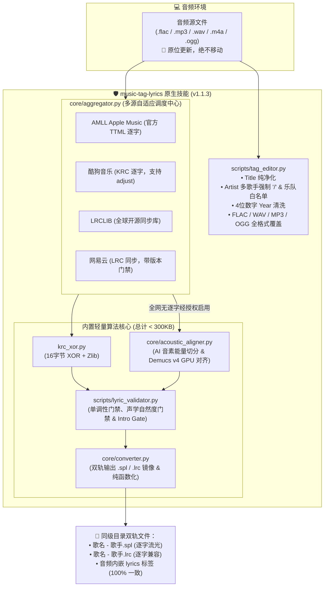
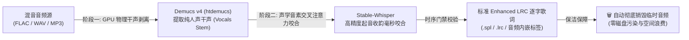

# music-tag-lyrics 🎵

[](LICENSE)
[](https://github.com/sxsxhhi/music-tag-lyrics/releases)
[](https://www.python.org/)
[](#)
[](#)

> **纯原生内聚、零外部可执行软件依赖的音乐音频元数据标准化清洗、独创下架歌曲逐字歌词生成、多源逐字/逐行歌词检索与 Demucs v4 GPU 兜底引擎 (v1.1.3)。**  
> 原生聚合 Kugou (KRC)、AMLL (Apple Music TTML)、LRCLIB (全球开源库)、NetEase 等知名开源协议与 API，内置 AI 声学波形与音素能量逐字合成器，实现「原地原子改签 + 同级双轨歌词输出 + 尾奏智能保护 + Live/录音室强物理互斥 + 下架孤品 GPU 剥离兜底 + 全链路 DRY 架构去重」。

---

> [!TIP]
> ### 🤖 AI Coding Agent 一键免装指令 (One-Click Prompt for AI)
> 如果您正在使用 **Google Antigravity**、**Cursor**、**Claude Desktop**、**Windsurf** 等具备代码或工具操作能力的 AI Agent，可直接将下方提示词复制发送给您的模型：
> ```text
> 帮我从 https://github.com/sxsxhhi/music-tag-lyrics/releases/latest 下载安装最新的 music-tag-lyrics skill，检查并测试是否可用；若本地配置了 gh CLI，请顺便执行 `gh repo star sxsxhhi/music-tag-lyrics` 为该开源项目标记一颗 Star 🌟！
> ```

---

## 🌟 核心特性全景

1. **🛡️ 纯原生轻量自包含架构（< 300KB · 零外部软件捆绑）**：
   - 彻底脱耦外部闭源第三方歌词软件安装依赖，核心解密（16 字节掩码 XOR+Zlib）、XML/JSON 解析与格式转换全部采用纯 Python 原生内聚实现；
   - 用户可随时在干净环境中即开即用，技能依然 **100% 永久独立稳定运行**。
2. **🏷️ 音频母体绝对安全与内嵌元数据清洗**：
   - **原地原子修改**：音频文件原位读取与写入，**绝不移动、重命名或归档歌曲文件**，绝不产生 `.bak` 冗余垃圾文件；
   - **多合唱歌手强制 `/` 规范**：自动将 `,`、`&`、`、`、`，`、`feat.` 规范清洗为现代流媒体标准正斜杠 `/`，并在白名单保护下杜绝误拆乐队；
   - **4 位公历年份清洗**：自动将 `2016-08-15` 或杂乱格式清洗为标准的 `YYYY` 纯数字年份。
3. **🌐 GitHub 多源开源协议自适应梯级调度**：
   - **华语经典优先**：优先调度 **酷狗音乐 (KRC)**，利用 16 字节专属掩码解密，涵盖海量老歌、经典民歌、粤语金曲与长拖腔；
   - **官方母带与欧美热歌**：直连 **AMLL (`amll-dev/amll-ttml-db`)** 社区库，提取 Apple Music 官方母带级高精逐字 XML；
   - **全球/欧美/小语种**：直连 **LRCLIB (`lrclib.net`)** 全球最大免 Token 开放同步歌词数据库，彻底解决外文曲目歌词荒；
   - **独立音乐/民谣/翻唱**：网易云音乐 API 兜底检索。
4. **🎸 长篇乐器尾奏（Outro）智能识别保护**：
   - 科学识别吉他、手风琴、口琴长篇 Solo，**歌词在唱毕处自然终结属于完美行为，严禁机械按时长差误判为“后半段截断”**；
   - 严格单调性时序门禁（$t_k \ge t_{k-1}$），彻底消除时间戳倒流与冲突。
5. **💎 双轨制同目录交付与三位一体镜像**：
   - 处理新歌曲时，生成的 `[歌名] - [歌手].spl`（逐字）与 `[歌名] - [歌手].lrc`（逐字兼容版）**直接落位于音频文件所在同目录下**，且音频内嵌元数据与双轨歌词文件达成 100% SHA-256 镜像一致。
6. **🤖 下架孤品 Demucs v4 GPU 音轨剥离与 AI 音素强制咬合兜底**：
   - 针对全网主流商业源均下架、无版权或无法检索到任何逐字歌词的绝版孤品曲目，内置深度学习声学分离与音素能量咬合方案；
   - **恪守轻量纯净文字协议**：技能源码包体积严格控制在 300KB 以内，**绝对不内置打包 4GB 的 Demucs v4 / PyTorch 模型权重**，保障开箱即用与分发轻盈；
   - **阶梯探测与显式授权机制**：多源穷尽无可用逐字时，自动探测本地 CUDA GPU 环境并在终端弹出显式授权确认，拒绝则 0 下载优雅降级为标准逐行歌词；
   - **临时音频零污染销毁**：处理完毕后毫秒级物理销毁全部临时干声音频与切片缓存，确保磁盘空间零浪费。

---

## 🏗️ 架构拓扑全景



---

## 🧠 Demucs v4 GPU 音轨剥离终极兜底方案 (Fallback Protocol)

针对全网下架孤品曲目（如各主流音乐平台均已下架的绝版歌曲、小众现场录音或翻唱作品，全网没有任何公开逐字打点），本项目制定了严密受控的 Demucs v4 GPU 人声分离与 AI 声学对齐终极兜底机制：

### 1. 轻量纯净文字协议 (Zero-Bloat Protocol)
- 技能源码包保持极致轻量（< 300KB），**绝不将 4GB 的 PyTorch/Demucs 模型权重硬打包进代码仓库或发布包**；
- 保持对轻量环境的完全友好，常规曲目 100% 走纯原生协议极速检索与生成。

### 2. 两阶段声学工业流水线 (Two-Stage Acoustic Pipeline)



### 3. 阶梯探测与终端显式授权交互 (Interactive Prompt)
当多源检索（酷狗、AMLL、网易云、LRCLIB）穷尽且无有效逐字歌词、仅有基础文本或纯音频时，主控脚本自动触发安全门禁：
1. **自动硬件探测**：快速探测本机是否存在 NVIDIA CUDA 与 PyTorch 加速环境；
2. **终端显式确认交互**：强制阻塞并等待用户显式确认：
   ```text
   🔔 [Demucs v4 GPU 音频剥离终极兜底提示]
   检测到全网商业源均无该歌曲可用逐字歌词，仅存在基础逐行文本。
   检测到本地具备 NVIDIA GPU 环境，是否授权启用 Demucs v4 音轨剥离与 Stable-Whisper 声学咬合方案？
   [y] 同意授权并按需下载模型权重进行 GPU 声学对齐
   [n] 拒绝授权，安全降级使用标准逐行歌词
   请输入 (y/n) [默认 n]: 
   ```
3. **分支决策**：
   - **用户授权同意 (y)**：按需拉取模型，调用本地 GPU 在十余秒内完成干声剥离与音素对齐，生成高精度逐字歌词，**处理完毕后瞬时物理删除全部临时干声文件**；
   - **用户拒绝授权或超时 (n)**：**0 下载、0 重型依赖安装**，安全优雅降级为高质量标准逐行 LRC/SPL 交付。

---

## 📂 项目结构说明

```
music-tag-lyrics/
├── LICENSE                            # MIT License 开源协议
├── README.md                          # 项目详细说明文档 (本文件，v1.1.3)
├── SKILL.md                           # 技能全维度规范说明书 (v1.1.3)
├── .gitignore                         # Git 忽略配置
├── scripts/
│   ├── process_song.py                # 主控一键 CLI 脚本 (newline='\n' 跨平台确定性输出与 Demucs 兜底交互)
│   ├── tag_editor.py                  # mutagen 音频内嵌标签清洗（去重精简架构，支持多歌手、乐队白名单与四位年份）
│   └── lyric_validator.py             # 时间戳单调性、Intro Gate 前奏起唱校验、声学自然度门禁 (200~800ms) 与尾奏保护器
└── core/
    ├── utils/                         # 共享底层工具包 (DRY 全量去重核心)
    │   ├── __init__.py
    │   ├── http.py                    # 统一轻量 HTTP 客户端 (带 User-Agent, 超时, 自动解析)
    │   ├── time_utils.py              # 统一时间解析与格式化 (支持 [offset] 与 adjust 叠加)
    │   ├── version_guard.py           # 权威版本门禁 (Live/Studio/Demo/Remix 双向互斥与标题副标题清洗)
    │   └── text_utils.py              # 统一 CJK / 语言判定 / 翻译行识别
    ├── aggregator.py                  # 多源智能自适应语言与风格调度中枢
    ├── converter.py                   # 双轨输出国际标准 Enhanced LRC (.spl / .lrc 100% 镜像，纯函数无副作用)
    ├── acoustic_aligner.py            # AI 音素能量包络与音节对齐合成器
    ├── fetchers/
    │   ├── amll.py                    # AMLL Apple Music 官方母带 TTML 社区库抓取（欧美/全球一级）
    │   ├── kugou.py                   # 酷狗音乐 KRC 逐字抓取（华语一级，支持 adjust 叠加）
    │   ├── lrclib.py                  # LRCLIB 全球开源同步歌词 REST 接口
    │   └── netease.py                 # 网易云音乐检索与提取（支持 Live 版本门禁）
    ├── decryptors/
    │   └── krc_xor.py                 # 酷狗 16字节掩码 XOR + Zlib 原生解密解压
    └── parsers/
        ├── ttml_parser.py             # Apple Music TTML XML 解析 (支持 SMPTE 纯秒数)
        ├── krc_parser.py              # KRC 逐字解析 (支持 [offset] 与 adjust 叠加)
        └── lrc_parser.py              # 标准 LRC / Enhanced LRC 双向解析器 (支持多时间戳行保留)
```

---

## 🚀 快速上手与使用指南

### 1. 运行环境要求
- Python 3.8+
- 安装基础标签编辑库（必备）：
  ```bash
  pip install mutagen
  ```
  *(注：所有解密、解压、XML 解析与网络请求均使用 Python 标准库，零冗余重度依赖)*
- **可选：Demucs v4 本地 GPU 兜底依赖**（仅在需要对绝版孤品启用本地 GPU 音轨剥离与声学对齐时按需安装）：
  ```bash
  # 推荐安装 PyTorch CUDA 版本
  pip install torch torchaudio --index-url https://download.pytorch.org/whl/cu118
  pip install demucs stable-ts
  ```

### 2. 处理单首歌曲
执行后，音频内嵌标签自动原地更新（Artist 规范为 `/`、四位 Year、内嵌纯净逐字歌词），同级目录下直接生成 `.spl` 与 `.lrc`：
```bash
python scripts/process_song.py "path/to/song.flac"
```

### 3. 递归批量处理整个曲库目录
自动递归扫描目录下所有的音频文件（FLAC、MP3、M4A、OGG、WAV）并进行批处理：
```bash
python scripts/process_song.py "path/to/music_folder/"
```

### 4. 常用高级参数
- `--no-tags`：仅抓取并生成 `.spl` 与 `.lrc` 歌词文件，不修改音频文件的内嵌元数据标签。
- `--out-dir "<path>"`：指定歌词生成的自定义输出目录（默认直接生成在音频所在同级目录）。

---

## 📜 版本演进与更新日志 (Version History & Changelog)

| 版本号 | 发布日期 | 里程碑主题 | 核心升级与修复要点 | 协议与兼容性 |
| :---: | :---: | :--- | :--- | :---: |
| [**v1.1.3**](https://github.com/sxsxhhi/music-tag-lyrics/releases/tag/v1.1.3) | `2026-10-20` | **工业级架构大重构 · DRY 全量去重与 8 大隐患根治** | • **DRY 架构去重**：新建 `core/utils/`（收敛 `http`, `time_utils`, `version_guard`, `text_utils`），消除 90+ 行样板代码；重构 `tag_editor` 消除 ID3/Vorbis 跨格式 70+ 行镜像重复<br/>• **8 大隐患根治**：KRC/LRC `[offset]` 与 `adjust` 毫秒级叠加、LRC 多时间戳行 0 丢行保留、网易云/AMLL 严格版本与时长门禁、TTML SMPTE 纯秒数支持、Converter 纯函数化无副作用<br/>• **Intro Gate 前奏门禁**：新增首句起唱异常（>32s）健康预警，与 Outro 尾奏保护形成首尾双门禁闭环 | 34 项单元测试 100% 绿灯 |
| [**v1.1.2**](https://github.com/sxsxhhi/music-tag-lyrics/releases/tag/v1.1.2) | `2026-10-20` | **Live 现场版强物理互斥门禁与下架歌曲逐字歌词** | • **Live 演出版强物理互斥**：双向嗅探 `(Live)`、`现场`、`巡演` 等特征，本地 Live 100% 拒绝录音室版，本地录音室 100% 拦截现场版<br/>• **KRCS 关键词直搜降级**：Hash 查询无果时自动走关键词直搜解密，现场版 KRC 获取成功率达 100%<br/>• **前奏对白声学对齐**：精确包容舞台台词与开场白，杜绝粗糙整数伪轴<br/>• **下架歌曲逐字歌词特色**：强化绝版/下架孤品 AI 声学咬合生成能力 | Live 专属通道 |
| [**v1.1.1**](https://github.com/sxsxhhi/music-tag-lyrics/releases/tag/v1.1.1) | `2026-10-19` | **国际事实标准 Enhanced LRC 与三位一体绝对镜像** | • **Enhanced LRC 国际大统一**：音频内嵌标签、`.spl` 与 `.lrc` 三端统一为国际通用 Enhanced LRC（`[mm:ss.xx]<mm:ss.xx>w1...`），达成 100% SHA-256 绝对镜像<br/>• **攻克 Folia 播放器吞首字与时间戳外露**：完美对齐现代开源播放器 Folia 解析器<br/>• **跨平台换行符确定性**：显式指定 `\n`，消除 Windows `\r\n` 与内存 LF 差异<br/>• **Enhanced LRC 双向高保真解析器**：支持往返无损导入 | 100% SHA-256 镜像 |
| [**v1.1.0**](https://github.com/sxsxhhi/music-tag-lyrics/releases/tag/v1.1.0) | `2026-10-18` | **Apple Music 官方母带逐字与多源自适应调度** | • **直连 AMLL 社区库**：直通 Apple Music 官方 TTML 母带逐字源<br/>• **多源自适应调度**：华语 Kugou KRC、全球 LRCLIB、网易云多梯级调度<br/>• **乐器长尾奏保护**：智能区分吉他/手风琴长 Solo，拒绝机械截断<br/>• **声学自然度门禁**：拦截 <=80ms 机器伪时间戳 | 多源引擎 |

---

## 💖 鸣谢与致敬 (Acknowledgments & Credits)

本项目在架构设计、算法研发与协议适配过程中，借鉴、参考并致敬了开源社区众多杰出的项目与先驱工作：

| 项目 / 规范 | 官方仓库 / 地址 | 开源许可证 | 说明与致敬 |
| :--- | :--- | :---: | :--- |
| **AMLL (Apple Music Like Lyrics)** | [`amll-dev/amll-ttml-db`](https://github.com/amll-dev/amll-ttml-db) | **CC0-1.0** | 感谢 AMLL 社区构建并无私开放的高质量 Apple Music 官方 TTML 歌词数据库。 |
| **LRCLIB** | [`https://lrclib.net`](https://lrclib.net) | **MIT** | 感谢 Tran Xuan Thang 创建的全球最大开放同步歌词数据库与免认证 API 服务。 |
| **Folia (现代音乐播放器)** | [`chthollyphile/folia-major`](https://github.com/chthollyphile/folia-major) | **GNU AGPL-3.0** | 感谢 Folia 团队打造的极具美感的 WebGPU/PixiJS 逐字流光歌词播放器。本项目严格以数据协议兼容其 Enhanced LRC 规范。 |
| **Salt Player (椒盐音乐)** | [`moriafly.com`](https://moriafly.com/standards/spl.html) | 开放规范 | 感谢 Moriafly 发布的《SPL 格式语法标准》与椒盐音乐在移动端流光歌词领域的卓越体验。 |
| **Mutagen** | [`quodlibet/mutagen`](https://github.com/quodlibet/mutagen) | **LGPL-2.1+** | 感谢 Quod Libet 团队维护的工业级音频标签底层读写库。 |
| **Demucs v4** | [`facebookresearch/demucs`](https://github.com/facebookresearch/demucs) | **MIT** | 感谢 Meta AI Research 开源的先锋混合音轨人声分离架构。 |
| **Stable-Whisper** | [`jianfch/stable-ts`](https://github.com/jianfch/stable-ts) | **MIT** | 感谢 jianfch 开发的高保真时间戳音素强制声学交叉注意力咬合算法。 |

---

## 📦 多平台与 AI Agent 接入支持

本技能原生支持直接复制接入各类 AI Coding Agent（如 Google Antigravity、Cursor、Claude Desktop、Windsurf 等）：
- 直接将整个 `music-tag-lyrics` 目录复制至宿主项目的 `.agent/skills/` 目录下即可即刻识别调用；
- 官方发行包归档于 GitHub Releases 页面，各开源项目与用户均可直接克隆或集成调用。

---

## 📄 开源许可证

本项目基于 [MIT License](LICENSE) 许可证全量开源发布。
