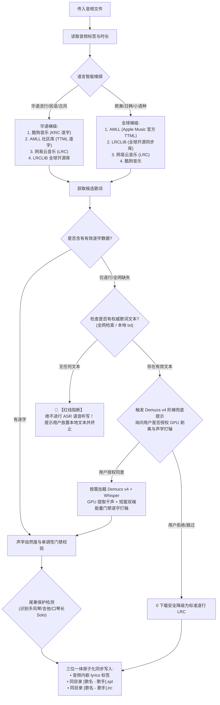

# music-tag-lyrics: 音乐标签与逐字歌词原生聚合引擎 (v1.2.4)

## 技能定位与核心价值

本技能专为工业级高质量本地音乐管理设计，提供全流程自动化的**音频内嵌元数据全维度清洗修补**、**多源双轨歌词（.spl 逐字 / .lrc 外挂）获取**与**下架孤品 GPU 双端声学咬合逐字打轴兜底**能力。

> [!IMPORTANT]
> **不依赖任何外部可执行软件（纯 Python 实现）**：
> - 核心加解密算法（KRC XOR+Zlib、TTML XML、LRC 解析）全部由技能内置的轻量 Python 模块实现（总计 < 300KB）；
> - **不依赖任何外部闭源软件、命令行工具或第三方程序**（无需 ffmpeg / Node / 播放器）；
> - Python 侧仅需两个 pip 包：`mutagen`（读写内嵌标签，**必需**）与 `numpy`（仅逐字合成需要，缺失即自动跳过合成）；
> - **零大模型捆绑负担**：绝不强行打包 4GB 重型模型文件，技能包时刻保持轻量纯净（Demucs 兜底路径为可选安装）。

---

## 一、核心规范与治理红线

### 1. 音频文件物理安全第一原则
- **原地修改，绝不移动**：音频文件仅由 `scripts/tag_editor.py` 在原路径原地更新内嵌元数据，严禁将歌曲移动、归档或删除！
- **歌曲与歌词同目录存放**：处理新音频时，生成的 `[歌名] - [歌手].spl` 与 `[歌名] - [歌手].lrc` **直接落位于该音频所在的同一文件夹内**。
- **FLAC 与 WAV 原生双轨支持**：FLAC 调用 VorbisComment (`lyrics`) 标签原子写入；WAV 调用 RIFF ID3 (`USLT::eng`, UTF-8 encoding=3) 标签原子写入，格式通杀。
- **用户手动修改元数据神圣不可侵犯**：当用户已手动校准音频标签或启用 `--lyrics-only` 时，仅原子覆写 `USLT` 内嵌歌词帧，`TIT2`（标题）、`TPE1`（歌手）、`TALB`（专辑）、`TDRC`（年份）、`TRCK`（音轨号）等核心标签 100% 保持字节级不变。

### 2. 多源开源引擎自适应梯级调度


---

## 二、全流程踩坑全景图与 18 条避坑铁律 (The Hall of Pitfalls & 18 Core Rules)

历经全库 1,027 首歌曲、下架孤品与 71 首全量外语曲库实战治理，深度复盘沉淀以下 18 条核心避坑铁律：

### 1. 乐器长尾奏（Outro）识别防假截断铁律
- **避坑痛点**：早先自动化脚本将“歌曲时长”减去“歌词最后一句时间”，若差值 > 30s 便武断判定歌词“残缺未唱完”，盲目降级抓取带有无意义时间戳的劣质网易云歌词，反将高精逐字 KRC 覆盖损毁；
- **声学规律**：大量经典名曲在歌手唱毕后拥有 1~2 分钟的宏大乐器尾奏（如赵雷《我们的时光》最后 100 秒口琴手风琴尾奏；梁博《表态》最后 2 分钟电吉他 Solo；BEYOND《灰色轨迹》最后 1.5 分钟双吉他 Solo）。歌手唱毕离场是正规母带的完美表现；
- **铁律准则**：严禁粗暴以时长差判定残缺！必须以“唱词语义完整性 + 尾段副歌重现度 + 歌手真实停唱点”综合判定，保护自然华彩尾奏。

### 2. 多歌手 `/` 连接符与乐队白名单保护铁律
- **避坑痛点**：在实施“多位合唱歌手必须使用 `/` 分隔以适配现代播放器”规范时，若简单将 `&` 全局替换为 `/`，会导致 `伍佰 & China Blue`、`Phoenix & The Turtles` 等经典乐队组合名称被暴力拆解；
- **铁律准则**：建立内置强制性的 `BAND_WHITELIST`。仅对真正的独立多合唱艺人（如 `徐良 & 小凌` $\rightarrow$ `徐良/小凌`、`陈慧琳 & 郑中基` $\rightarrow$ `陈慧琳/郑中基`）执行正斜杠转换，乐队/乐团名称 100% 物理锁定原样保留。

### 3. 非国语标准 ELRC 动态流光与防跳屏铁律 (ELRC Bilingual Pairing & Screen-Jumping Prevention)
- **避坑痛点**：国内平台爬取的非国语双语歌词中，中文翻译行常被赋予**独立的起止时间戳**（插在外文歌词间隙）。手机与车载播放器（如椒盐音乐、Folia、AMLL）把独立时间戳当做真实开唱事件，导致每隔 0.5s~1s 就在外文和中文之间上下疯狂跳跃，画面剧烈抽搐；
- **铁律准则**：非国语歌曲全面实行**国际标准 Enhanced LRC (ELRC) 规范**：
  1. **母体时间戳绝对咬合**：中文翻译副行必须严格继承对应外语原唱逐字主行的起唱时间戳 `[mm:ss.xx]`，且紧随主行下方排列；
  2. **副行零打点纯净字幕**：副行仅包含纯文本翻译，绝对严禁插入 `<>` 伪逐字时间标签，确保原唱行专享毫秒级高亮流光，译文行作为静止字幕同步衬托；
  3. **协同 Rule 13 红线**：仅采纳官方/专业人工审校精修译文；若各大平台均无官方译文，坚决保持纯净外文原版歌词呈现，杜绝假演唱行与机械机翻，实现丝滑连续流光。

### 4. 声学自然度门禁（Natural Acoustic Gate）防挤压铁律
- **避坑痛点**：历史平滑脚本遇到双语共享同时间戳时，误以为是逆流冲突，推挤时间线时暴力采用 `curr_t + 0.04` 强行箝位，把每行前几个单词的发音时长压缩到了 40 毫秒（0.04s）伪打点！播放器在十分之一秒内瞬间狂飙过前几个词，直插行中；
- **铁律准则**：建立声学自然度门禁。人类单字/单词发音通常处于 200ms~800ms 区间，严禁任何 <=80ms 机器伪时间戳。任何平滑算法不得压缩真实声学时长，全量基于高保真母带源生成。

### 5. 外文经典金曲 Apple Music 官方母带逐字直连铁律
- **避坑痛点**：依赖国内单平台抓取欧美流行金曲（如《Closer》），往往得到每个英文字母切成 40ms 碎块的伪逐字；
- **铁律准则**：非国语欧美流行热单优先直连 Apple Music 官方母带逐字 TTML 数据库（AMLL），直接提取原厂词级咬合打点。

### 6. 三位一体国际标准 Enhanced LRC 与 100% SHA-256 镜像铁律
- **避坑痛点**：旧版私有 SPL 格式首字缺失前置 `<start>` 且行尾带有 `[end]` 方括号语法糖，导致开源播放器 Folia 吞掉每行首字并把行末方括号时间戳渲染到屏幕上，而若仅修改 LRC 又会导致内嵌标签、.spl、.lrc 格式分裂；
- **铁律准则**：全面实行「三位一体大统一」。统一采用国际事实标准 Enhanced LRC（`[mm:ss.xx]<mm:ss.xx>w1<t2>...<tend>`），**音频内嵌 lyrics 标签 == 同级 .spl == 同级 .lrc**，三端 100% 具备毫秒逐字流光能力，100% SHA-256 绝对镜像！在 Folia、AMLL、椒盐音乐、以及车载车机/AIMP 等传统播放器中实现 100% 全生态兼容。

### 7. 跨平台换行符确定性对齐铁律 (Windows Newline Determinism)
- **避坑痛点**：Windows 环境下 Python 文本文件写入默认将 `\n` 自动转换为 `\r\n` (CRLF)，而音频内嵌标签（Mutagen）在内存与流中保持 `\n` (LF)，导致磁盘文件与音频内嵌标签出现微小字节差异而破坏哈希一致性；
- **铁律准则**：所有歌词文件输出时显式指定 `newline="\n"`，确保无论在 Windows、Linux 还是 macOS 运行，全平台产出的二进制字节流 100% 保持一致，物理保证 `sha256(embedded) == sha256(.spl) == sha256(.lrc)`。

### 8. 标点符号 0ms 冗余清洗铁律
- **避坑痛点**：爬虫源中连续标点（如 `...` 或全角括号 `（`）常被赋予 0ms 相同时间戳，导致解析器事件阻塞；
- **铁律准则**：自动折叠消除标点符号上的 0ms 重复标签，将标点作为字符直接依附于相邻词汇。

### 9. Live 演出版与录音室版本强物理互斥防串扰铁律 (Version Awareness & Live Acoustic Guard)
- **避坑痛点**：在桌面「只音」治理中暴露的核心盲区：歌曲在线检索若仅凭简单歌名加歌手以及宽松的时长差（如 <= 3s 或 5s），极易发生严重版本错配：
  1. **现场版误判为录音室版**：如《一腔诗意喂了狗 (Live)》巡演版时长为 230.4s，而录音室版仅 131s（相差近 100 秒），若检索词去除了 `(Live)` 或在曲库中按录音室版检索，会导致抓取到 131s 的录音室歌词，歌词提前 100 秒跑完，全篇报废；
  2. **录音室版误混入现场版**：公网各大平台对于热门流行金曲（如《事事》、《归去来兮》、《安然无恙》、《美好事物》）常有高热度的现场版（Live），若候选源匹配算法未执行强物理互斥隔离，录音室音频极易误匹配到含有现场对白、加长尾奏或即兴改词的 Live 歌词；
  3. **Hash 查询接口对现场版失效**：各大音乐平台（如酷狗）的 Hash 精准反查接口常对现场版返回空候选，若缺乏二级关键词与时长双向降级检索（`krcs.kugou.com/search?keyword=...&duration=...`），会导致直接判定无逐字源而错误降级；
  4. **现场前奏对白（Stage Banter）声学起唱对齐**：现场演出版通常在正式开口前有长达数十秒的歌手说话、舞台互动或乐队调音，首句时间戳绝不能粗暴套用录音室版的 00:00，也不能轻信人工随手写的 `.00` 整数伪轴（如 23.00s），必须以现场官方高精度声学轴或能量检测开唱点（如 32.69s）对齐。
- **铁律准则**：全面实行强物理互斥双轨检索隔离与 KRCS 关键词降级通道。
  1. **本地音频为 Live 版**：候选必须严格具备 Live/现场 标识，100% 拒绝任何普通录音室歌词混入；
  2. **本地音频为录音室版**：候选若含有 Live/现场 标识，100% 物理拦截剔除，彻底杜绝即兴改词与现场台词污染母带；
  3. **三阶检索与 Hash-to-Keyword 双轨降级**：若 Hash 反查无结果，自动降级至 `krcs` 关键词直搜 + 时长过滤，通过 `id` 与 `accesskey` 走 `download` 接口解密；
  4. **标题括号智能分级**：版本括号（如 `(Live)`、`(Demo)`）保留参与版本匹配，副标题括号二次降级，营销垃圾括号物理清除。

### 10. 全链路 [offset] / adjust 叠加与前奏异常门禁铁律 (Offset & Intro Gate)
- **避坑痛点**：
  1. **[offset] 标签忽略导致的系统性时间平移**：公网解密 KRC 或开源 LRC 顶部常带 `[offset:1500]`（或负值），若解析时仅存入字典而未应用到时间戳算术中，全曲歌词在播放时将整体滞后或抢跑数秒；
  2. **服务端 adjust 校准量被丢弃**：酷狗等平台返回的候选带有官方微调字段 `adjust`，若下载解密后未与 offset 叠加，会丢掉官方精细校准数据；
  3. **前奏起唱异常迟滞（Intro Stage Banter）缺乏预警**：普通流行歌曲若首句开唱在 32s、40s 甚至更晚，常由于源歌词包含了未经剪辑的舞台废话或不同演唱会切片；
  4. **LRC 多时间戳压缩行丢行**：经典 LRC 规范允许多个 `[mm:ss.xx]` 共用一行歌词（如副歌复用），若解析器仅取最后一个时间标签，前半首的歌词将发生大段静默丢失。
- **铁律准则**：
  1. **全解析器毫秒级 [offset] 与 adjust 强制叠加**：`krc_parser`、`lrc_parser`、`ttml_parser` 解析行/字时间戳时，强制统一叠加 `total_offset = offset + adjust`，并使用 `>= 0` 物理箝位；
  2. **LRC 多时间戳行 100% 独立保留**：遍历提取每个时间标签，生成独立的唱词条目，0 丢行；
  3. **Intro Gate 前奏起唱健康门禁**：常规歌曲（>90s）若首句非报幕歌词起唱时间 > 32s，触发高显警告提示，杜绝未修剪切片混入。

### 11. 【核心红线】绝不语音听写，必须先检后轴铁律 (Never Transcribe Blindly)
- **避坑痛点**：在对下架孤品（如李志系列经典）进行 AI 语音转写测试中暴露了致命缺陷：
  1. **高频同音与近音词错位**：Whisper 等 ASR 模型在混杂背景音乐与伴奏时错词率高达 10%~30%（如将“幽暗”听写为“游暗心”，将“西班牙先民”听写为“西斑牙先鸣”，将“生活逼”听写为“生活的皮”）；
  2. **分段排版灾难坍缩**：ASR 缺乏乐理段落感知，极易将 3~4 行独立的四行诗或副歌暴力捏合成单行大长句，彻底破坏歌词律动与排版；
  3. **幻觉歌词生成**：在乐器间奏或模糊咬字阶段，ASR 模型会依据自回归概率凭空捏造无意义词汇。
- **铁律准则**：**严禁任何形式的 ASR 盲目语音听写！**
  1. **先检后轴**：使用 Demucs v4 终极兜底方案时，**必须且只能先从全网/全球开源库或本地定向检索获取权威逐行歌词文本**；
  2. **强制对齐 (Forced Alignment)**：在确保歌词文本 100% 正确的前提下，仅将 GPU 与 Whisper 交叉注意力作为“声学打轴工具”（时间戳对齐器），绝对严禁根据语音修改或发明歌词字词；
  3. **零文本绝对阻断**：若全网未检索到任何有效歌词文本，且本地未提供 `[歌名 - 歌手.txt]`，**程序必须立刻触发红线机制强行阻断并退出**，明确指导用户放置本地文本后再行重试，绝不妥协使用语音转文字生成任何文字！

### 12. 双端声学能量门禁与间隙防拉伸铁律 (Dual-Ended Acoustic Gates & Pause Gap Tagging)
- **避坑痛点**：
  1. **行首抢跑假流光 (Premature Onset)**：模型全局打轴对长前奏或句间起唱缺乏敏锐边界，常在歌手尚未开口前 0.5s~1s 就提前点亮首字；
  2. **行末拖沓假唱 (Lingering Offset)**：结尾字音唱完已进入休止，但时间戳因衰减尾音判定向后拖延 1~2 秒，造成视觉假唱；
  3. **乐器长间奏全局崩溃 (Interlude DTW Collapse)**：整曲全局对齐缺少静音跳过机制，遇到 30 秒吉他 Solo 时，DTW 会把一个字强行拉伸 30 秒或跳词，导致后半首整体漂移 30 多秒；
  4. **字间停顿虚空变色**：一句话中包含较长逗号停顿（如“我已忘了……是什么”）时，前一个词若无闭合标签，流光会在停顿处匀速缓慢爬行，产生滞涩感。
- **铁律准则**：
  1. **短窗隔离切分 (Hybrid Window Partitioning)**：严禁全曲全局大跨度对齐！依托粗时间戳划窗或 VAD 人声能量切片，将间奏与长 Solo（$\ge 2.5\text{s}$）物理隔离在窗外；
  2. **行首逆向能量回溯门禁 (Backward Onset Gate)**：以 15ms 步长在 `vocals.mono` 逆向回溯，精准锁定人声起始突跃点（$RMS \ge \max(0.02, \text{peak}\times 0.20)$），彻底消除抢跑；
  3. **行末正向能量跌落门禁 (Forward Offset Gate)**：以 20ms 步长正向探测能量，连续衰减跌破 $RMS < 0.015$ 时精准截断收尾，消除拖沓；
  4. **行内停顿闭合标签 (Pause Gap Tags)**：字间停顿 $\ge 300\text{ms}$ 时，自动在行内插入闭合时间戳 `<w1_end><w2_start>`，严防流光贯穿停顿。

### 13. 【核心红线】绝不机械机翻，必须采用官方/人工审校精修翻译铁律 (Never Machine Translate Blindly)
- **避坑痛点**：外语音乐具有独特的押韵（Rhyme）、流光律动（Flow）、俚语典故与时代意象，盲目使用机械机翻（Google/百度翻译或未经乐理审校的直译大模型）会产生灾难性后果：
  1. **歌词艺术灵魂与押韵彻底丧失**：俚语与双关语被字面硬译成荒诞怪诞的中文句子（如流行热单《Closer》中的名句 "In the backseat of your Rover that I know you can't afford"，机械机翻直译为“在我知道你买不起的粗纱机后座”，沦为胡言乱语；官方精修翻译则雅译为“在你那辆我深知你买不起的路虎后座上”，意境神形兼备）；
  2. **多义词与语境错位崩溃**：歌词中丰富的暗喻、口语缩写与上下文指代在逐字直翻下全线失真，完全背离创作者原本的情感内核；
  3. **伪翻译投毒与本地母带曲库污染**：低劣的机翻一旦随同 Enhanced LRC 或内嵌 USLT 标签永久写入用户珍藏的本地高解析度无损母带音频与歌词文件，等同于在纯净音质库中投毒，严重破坏视听享受。
- **铁律准则**：**严禁任何形式的盲目机械机翻！绝不为了“强行补齐中文翻译”而调用机翻污染歌词！**
  1. **官方审校精修优先**：非国语歌曲若需配置中文翻译，**必须且仅能从网易云（`tlyric`）、QQ 音乐（`trans`）等官方版权平台获取经过专业音乐编辑、译者与乐评人深度校准的精修翻译文本**；
  2. **标准 ELRC 时间戳绝对母体咬合**：官方翻译必须严格继承原唱行的起唱时间戳，且作为翻译行紧随其后（不含 `<>` 逐字打点），严禁生成独立时间戳交替插队造成播放器跳屏；
  3. **无官方精修则坚守纯净原版**：若各大官方平台均未提供官方中文翻译，**必须坚决保持纯净外文原版歌词呈现，严禁使用任何机械机翻强行塞入！**宁缺毋滥，时刻捍卫高品质音乐曲库的严谨性与纯粹性。

### 14. 外文词界空格标准注入与 \xa0 网页假空格消融铁律 (Word Boundary Space Normalization & Non-Breaking Space Removal)
- **避坑痛点**：在对欧美流行与小语种曲库（如《Closer》、《Rolling in the Deep》等）实战治理中暴露了两大致命排版缺陷：
  1. **词界逐字时间戳黏连断层**：部分商业源（如 KRC、部分 TTML）在解析西文字词时，直接将 `<time>word` 相连而丢失了词间空格（如 `<00:10.29>Hey,<00:11.72>I<00:12.05>was<00:12.26>doing...`），导致在播放器渲染时整句话的单词全部挤压黏连在一起（`Hey,Iwasdoingjustfine`），阅读体验极度压抑；
  2. **网页不间断空格（`\xa0` / `&nbsp;`）投毒**：从公网或 Web API 爬取的歌词常携带不可见的非换行空格（`\xa0`），在部分移动端、开源播放器或车载车机上无法正常断行，甚至被渲染为方块乱码或问号；
  3. **标点空格倒置**：逗号、句号等标点与前后单词边界缺乏自然语法空隙。
- **铁律准则**：
  1. **词界标准空格强制注入**：在组装 Standard Enhanced LRC / SPL 时，西文单词之间必须在 `<mm:ss.xx>` 时间戳前或单词后强制保留标准 ASCII 空格（`\x20`），确保高亮流光平滑推进的同时，单词间拥有清爽自然的排版呼吸感；
  2. **全流程消融 `\xa0` 假空格**：所有导入、转换、生成与内嵌的歌词文本，底层统一执行 `text.replace('\xa0', ' ')` 净化清洗，消除一切隐性非标空格；
  3. **标点语法自然咬合**：标点紧随词末，标点之后保持标准空距，彻底根除西文歌词黏连病灶。

### 15. 【核心红线】酷狗 KRC 语义翻译与音译防混淆硬门禁 (Semantic Translation vs Romanization Gate)
- **避坑痛点**：酷狗 KRC 的 `[language:]` 标签解码后包含多个语言轨道。其中 `type: 0` 为音译/假名/罗马音（Romanization），如韩文歌曲中的“撒朗”、“内扑们”、“他楞”；`type: 1` 才是真正的中文语义意译（`zh-Hans`）。若未严格校验 `type` 或粗暴提取首项，会将空耳音译假冒成中文翻译注入歌词，导致外语歌词全部乱码；
- **铁律准则**：
  1. **严格限定 `type == 1`**：解析酷狗 KRC `[language:]` 扩展元数据时，必须且仅能匹配 `type == 1`；
  2. **汉字字符集硬门禁**：所提取的翻译文本必须经过汉字检测校验（`re.search(r"[\u4e00-\u9fff]", text)`），杜绝无汉字的罗马拼音或日文假名冒充翻译；
  3. **空耳音译绝对丢弃**：严禁获取 `type: 0` 作为翻译，亦不将罗马音注入标准双语流光（保持极简双语，杜绝三行跳屏）。若无原生 `type: 1` 意译，明确判定酷狗“无原生语义翻译”，立即触发外部源降级。

### 16. 【核心红线】纯音乐占位防篡改与有效行数门禁 (Line Count Integrity & Anti-Placeholder Gate)
- **避坑痛点**：第三方或云端检索时，部分纯音乐/伴奏/Instrumental 候选包含 4~5 行占位词（如“纯音乐，请欣赏”），若仅以“候选带有翻译标签”为由盲信覆盖，会导致声乐原本拥有的 40 多行高质量逐字歌词被伴奏占位词暴力覆盖毁灭（如《Perfect - Ed Sheeran》事故）；
- **铁律准则**：
  1. **占位词关键词强拦截**：候选歌词文本若包含“纯音乐”、“伴奏”、“请欣赏”、“Instrumental”、“No Lyrics”等占位词，严禁用于声乐曲目；
  2. **最低有效行数门禁**：常规声乐曲目（时长 $>60\text{s}$ 且原词 $\ge 10$ 行）严禁被 $\le 6$ 行的候选词覆盖；
  3. **行数比例熔断**：候选翻译行数低于 $\max(4,\ 0.3 \times$ 原词行数$)$ 时触发防篡改熔断，绝对禁止替换原词。

### 17. 【核心红线】物理时长严密邻近与版本防串扰门禁 (Duration Proximity Gate)
- **避坑痛点**：同一歌曲常有录音室原版、Remix 混音版、Radio Edit 剪辑版、加长版（Extended）等不同物理时长的版本。若只凭歌名与艺术家检索，极易把 287 秒的原版歌词套用到 225 秒的混音版上（如《Y.M.C.A (Pure Disco)》事故），导致整曲起唱与时间轴严重漂移 15 秒以上；
- **铁律准则**：
  1. **分源时长门禁**（实测容差各不相同，不可统一）：LRCSHARE 解析末行 $\pm 5.0\text{s}$；酷狗元数据 $\pm 10\text{s}$、解析末行 $\pm 8.0\text{s}$；网易云/LRCLIB 搜索元数据 $\pm 35\text{s}$；
  2. **严重偏差物理剔除**：当已知目标物理时长且时长偏差 $> 8.0\text{s}$ 时，严禁仅因“含有翻译”而加分采纳；偏差 $> 15.0\text{s}$ 时物理剔除该候选，防止不同剪辑版相互串扰。

### 18. 【核心红线】黄金基准时间轴锚定与动态微调门禁 (Golden Baseline Timing Anchor)
- **避坑痛点**：为了获取中文翻译，盲信带有译文的第三方整体歌词，直接覆盖了本地已经实测验证精准的黄金逐字时间轴，导致原本精确的歌词产生快慢滚动偏差或几秒的延迟（如《Nothing On You》、《doa - 英雄》事故）；
- **铁律准则**：
  1. **基准时间戳享有最高真理权**：本地已实测、或已存在基准 `.spl` 逐字打轴的音频，其时间戳不可侵犯；外语中文翻译仅作为“语义附加层”对齐挂载，绝对严禁用未经检验的第三方时间戳覆盖原生精准打轴；
  2. **$\le 1500\text{ms}$ 允许作为译文挂载窗口**：译文行按最近邻时间戳挂到主行，**不修改任何主行时间戳**；
  3. **主行时间戳永不被译文改写**：无论偏差多大，主唱行时间轴保持原样，译文只作为语义附加层；

---

## 三、音频内嵌元数据全维度治理与修补体系 (Metadata Specification)

音频元数据与歌词同等重要，本技能将音频标签治理列为核心标准功能：

| 元数据字段 | 标准化治理规范 | 严禁项与过滤规则 | 治理执行范例 |
| :--- | :--- | :--- | :--- |
| **Title（标题）** | 纯净歌曲原名，保留官方副标题括号 | 剔除 `[FLAC-无损]`、`【HQ高品质】`、宣发推广尾缀 | `Closer [简明宣发版...]` $\rightarrow$ `Closer` |
| **Artist（艺术家）** | 多位合唱歌手强制统一使用正斜杠 `/` 分隔 | 严禁 `,`、`&`、`、`、`feat.`；严禁误拆白名单乐队 | `徐良 & 小凌` $\rightarrow$ `徐良/小凌`；`伍佰 & China Blue` 原样保护 |
| **Album（专辑）** | 发行母带所属正规录音室专辑或同名独立单曲 | 严禁拼盘假精选、平台热歌榜名（如“热歌精选”） | 准确归档至发行母带所属专辑 |
| **Year（年份）** | 严格统一为 4 位纯数字公历年份（`YYYY`） | 严禁附带月日（`YYYY-MM-DD`）、时间戳或空白缺失 | `2016-08-01` $\rightarrow$ `2016`；缺失者精准补齐 |
| **Lyricist（作词）** | 原创作者真名，多作者以 `/` 分隔 | 严禁空白占位；已有的白名单保护，缺失且前奏充裕时注入 | `作词 : 竹君` |
| **Composer（作曲）** | 原创作者真名，多作者以 `/` 分隔 | 严禁空白占位；已有的白名单保护，缺失且前奏充裕时注入 | `作曲 : 暗杠` |
| **Lyrics（内嵌歌词）** | 注入高精度标准 Enhanced LRC / SPL 逐字歌词内容 | 严禁嵌入带独立时间戳的插队中文翻译行；FLAC/WAV 双轨写入 | 100% 与外部 `.spl` / `.lrc` 绝对一致 |

---

## 四、Demucs v4 GPU 音频剥离与声学咬合终极兜底方案 (Fallback Protocol)

针对全网下架孤品、独立无版权曲目（如《关于郑州的记忆 - 李志》、《1990年的春天 - 李志》），建立标准化的声学打轴兜底流水线：

### 1. 轻量纯净原则（零 4GB 捆绑）
技能包源码体积始终控制在 300KB 以内，**绝对不内置打包 4GB 的 Demucs v4 / PyTorch 模型权重**，保障分发与同步极速纯净。

### 2. 阶梯探测与红线阻断机制
1. **自动前置校验**：当全网商业曲库无逐字打点时，系统首先检索全网与本地是否具备权威纯文本歌词。
2. **红线拦截**：若全网及本地均无任何权威歌词，立即触发红线阻断：
   ```text
   🛑 [Demucs v4 绝对红线阻断 (v1.2.4)]
   未能从商业曲库检索到《歌曲 - 歌手》的有效歌词，且本地未提供纯文本歌词。
   ⚠️ 核心铁律：【绝不语音听写，使用 Demucs v4 兜底时必须先从全网检索歌词，在正确歌词的基础上进行逐字打轴】！
   👉 解决方案：请在歌曲所在目录下放置纯文本歌词文件《歌曲 - 歌手.txt》后再重试。
   ```
3. **用户显式授权协议**：当已获取权威歌词文本时，弹出授权提示：
   ```text
   🔔 [Demucs v4 GPU 音频剥离与声学打轴授权提示 (v1.2.4)]
   已定位到权威歌词文本（共 X 行）。
   是否授权按需使用本地 GPU 调用 Demucs v4 剥离纯人声并进行双端能量门禁逐字声学咬合？
   （声明：绝对遵循权威歌词文本，零 ASR 语音听写；任务完成后自动销毁临时干声文件）
   [Y: 授权同意运行 GPU 打轴 / N: 拒绝授权并跳过]
   ```
4. **用户授权同意（Accept）**：
   - 调用 GPU 极速提取干声 `vocals.mono`；
   - 采用短窗切分 + Whisper Forced Alignment 在权威文本上进行交叉注意力咬合；
   - 经过双端声学能量门禁（Onset 15ms 回溯 + Offset 20ms 截断）与间隙闭合标签后，输出高精逐字数据；
   - 自动清除临时文件，无残留。
5. **用户拒绝授权（Reject）**：
   - 0 下载，安全退出。

---

## 五、使用指南与 CLI 指令

### 1. 一键处理单首歌曲（标签清洗 + 逐字歌词生成）
```bash
python scripts/process_song.py "path/to/song.flac"
```

### 2. 仅修补歌词，绝不破坏用户手动维护的元数据标签
```bash
python scripts/process_song.py "path/to/song.flac" --lyrics-only
```

### 3. 强制启用本地 GPU Demucs v4 声学咬合打轴（针对下架孤品或需重打轴）
```bash
python scripts/process_song.py "path/to/song.flac" --force-gpu
```

### 4. 指定外部权威纯文本歌词打轴
```bash
python scripts/process_song.py "path/to/song.flac" --force-gpu --lyrics-file "path/to/lyrics.txt"
```

### 5. 批量处理整个目录
```bash
python scripts/process_song.py "path/to/music_folder/"
```

### 6. 可选参数汇总
- `--no-tags`：仅抓取并生成双轨歌词，不修改音频文件的任何内嵌元数据标签。
- `--lyrics-only`：仅更新内嵌歌词（`USLT` 帧），100% 保护用户手动修改的标题、歌手、专辑、年份等元数据。
- `--force-gpu`：强制启用 Demucs v4 + Whisper 进行 GPU 声学双端门禁逐字打轴。
- `--lyrics-file "<path>"`：指定外部权威纯文本歌词文件路径。
- `--out-dir "<path>"`：指定歌词输出目录（默认输出在音频文件同级目录）。
- `--non-interactive`：无人值守模式，不弹 Demucs 授权确认（直接跳过兜底）；批量跑批与 CI 建议开启。

---

## 六、代码组织与模块索引

```
music-tag-lyrics/
├── LICENSE                            # MIT License 开源协议
├── SKILL.md                           # 技能全维度规范体系（本文件，v1.2.4）
├── README.md                          # 面向 GitHub 部署的开源文档与 Release 说明 (v1.2.4)
├── requirements.txt                   # 必需依赖：mutagen（numpy 仅逐字合成需要）
├── requirements-acoustic.txt          # 可选依赖：Demucs v4 声学打轴兜底
├── scripts/
│   ├── process_song.py                # 顶层一键 CLI 执行流水线 (newline='\n' 确定性输出，支持 --lyrics-only 与 --force-gpu)
│   ├── tag_editor.py                  # mutagen 音频标签清洗（去重精简架构，多歌手'/'、乐队白名单、四位年份、全格式覆盖）
│   └── lyric_validator.py             # 声学自然度门禁(200~800ms)、Intro Gate 前奏起唱校验、单调性校验与乐器尾奏保护
├── tests/                             # 离线回归测试与基线跑批（24 条用例，不联网）
│   ├── test_parsers.py                # 解析层：LRC / SPL / TTML / 时间戳
│   ├── test_m1_safety.py              # 标签安全、空值归一、原子写
│   ├── test_pipeline.py               # 流水线：双语剥离 / 校验门禁 / 坏 ID3
│   └── run_baseline.py                # 9 首基线跑批（产物强制落在仓库外）
└── core/
    ├── utils/                         # 共享底层工具包 (DRY 架构去重核心)
    │   ├── __init__.py
    │   ├── http.py                    # 统一轻量 HTTP 客户端 (User-Agent, 超时, 自动解析)
    │   ├── time_utils.py              # 统一时间解析与格式化 (支持 [offset] 与 adjust 叠加)
    │   ├── version_guard.py           # 权威版本门禁 (Live/Studio/Demo/Remix 双向互斥与标题副标题清洗)
    │   ├── text_utils.py              # 统一 CJK / 语言判定 / 翻译行识别
    │   └── io_safe.py                 # 原子写与「副本改写→原子替换」的音频标签落盘
    ├── aggregator.py                  # 多源智能自适应调度中枢 (v1.2.4 3-Tier外语翻译级联与动态微调基准时间轴锚定)
    ├── converter.py                   # 双轨输出标准 Enhanced LRC (支持 join 词边界标记、\xa0消融、ELRC双语与停顿闭合标签)
    ├── acoustic_aligner.py            # Demucs v4 人声分离与 Whisper 双端能量门禁逐字声学咬合引擎 (核心兜底)
    ├── fetchers/
    │   ├── amll.py                    # AMLL Apple Music 官方母带 TTML 社区库抓取（欧美/全球一级）
    │   ├── kugou.py                   # 酷狗音乐 KRC 逐字抓取（华语一级，支持 adjust 叠加与时长门禁）
    │   ├── lrcshare.py                # LRCSHARE 云端 TTML/逐词/多语言结构化抓取（负向预过滤与24h Session保持）
    │   ├── lrclib.py                  # LRCLIB 全球开源同步歌词 REST 接口
    │   └── netease.py                 # 网易云音乐检索与提取（支持 Live 版本门禁与 tlyric 意译）
    ├── decryptors/
    │   └── krc_xor.py                 # 酷狗 16字节掩码 XOR + Zlib 原生解密解压
    └── parsers/
        ├── _common.py                 # 解析器共享工具（[offset] 标签解析，KRC/LRC 共用）
        ├── ttml_parser.py             # Apple Music TTML XML 解析 (支持 SMPTE 纯秒数)
        ├── krc_parser.py              # KRC 逐字解析 (严格 type:1 语义翻译门禁，丢弃 type:0 罗马音)
        └── lrc_parser.py              # 标准 LRC / Enhanced LRC 双向解析器 (支持多时间戳行保留)
```

---

## 七、开源分发与多平台接入机制

- **官方开源代码仓库**：`https://github.com/sxsxhhi/music-tag-lyrics`
- **最新 Release 发行包**：`https://github.com/sxsxhhi/music-tag-lyrics/releases/latest`
- **规范维护准则**：任何功能扩展、代码重构、BUG 修复或规范升级均在此仓库持续演进，并保证发布分发包（`-skill.zip`）时刻保持纯净、最新与可独立部署状态。
