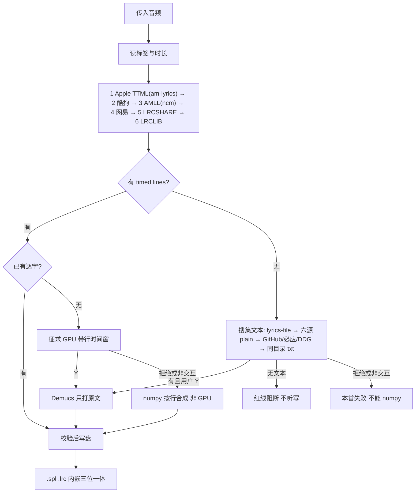

# music-tag-lyrics: 音乐标签与逐字歌词原生聚合引擎 (v1.3.5)

纯 Python 技能：原地洗标签、多源抓词、同目录写出 `.spl` / `.lrc`。缺标题/歌手按文件名「歌名-歌手」补全；作词/作曲仅在空时从歌词署名行提取。Python 侧需 `mutagen`；`numpy` 仅在拒绝 GPU / 非交互时用于行级合成；Demucs GPU 为精度优先的可选兜底。抓词失败仍可只写清洗后的元数据。

> **不依赖 ffmpeg / Node / 播放器。** 绝不移动、归档或删除音频。`--lyrics-only` 只覆写内嵌歌词帧。

---

## 一、调度与写盘



- **Apple TTML 升为第 1 档（v1.3.0）**：所有曲目优先通过本地索引（`am-lyrics/index.jsonl`，2,745 行折叠聚合为 1,773 组）与 iTunes 实时检索（search 四区 hk/tw/us/jp；lookup 华语 us→cn、外语 us→jp）发现 Apple ID；多镜像按 origin 攒票回退拉取 TTML；iTunes 令牌桶 24 容量 / 1.6 每秒，耗尽时打印可见降级日志。
- **华语 Strict 门禁防串歌（D4）**：华语曲目必须严格通过标题严格相等、艺人交集、版本互斥、时长证据（E1 iTunes trackTimeMillis 对齐或 E2 专辑+E3b 吻合），才允许作为 strict 候选覆盖酷狗；任何 loose 华语一律返回空平滑落入酷狗。
- **外语单调等级替换（D5 / D6）**：原文与译文必须同一源、同一版。后序源必须具备严格更高等级（`_rank`：逐字+译文(3) > 行级+译文(2) > 逐字无译文(1) > 行级无译文(0)）才能整包替换前置源；外语缺译文的 Apple 逐字允许被后续带官方译文的网易/LRCSHARE 整包替换。
- Demucs **不是第七个抓词 API**。有行无字：精度优先问 GPU（`line_timing_hints`）；拒绝/非交互才 numpy。无 `lines`：先全球搜权威文本（GitHub/raw 优先），再问 GPU；拒绝不能 numpy。
- `--non-interactive`：有行轴则直接 numpy；无行轴则跳过 GPU，本首失败。
- **专辑封面补全（v1.3.2）**：默认写标签路径生效；已有内嵌封面 100% 物理跳过绝不覆盖；详见第三节封面规范。
- 回滚与开关：支持 `--no-apple-ttml`、`--no-cover` 与环境变量 `MTL_APPLE_TIER=off`。

安装与 CLI 见 `README.md`。

---

## 二、18 条避坑铁律

### 1. 乐器长尾奏（Outro）识别防假截断铁律
- **铁律准则**：严禁粗暴以时长差判定残缺。必须以唱词语义完整性、尾段副歌重现度、歌手真实停唱点综合判定，保护自然华彩尾奏。
- **解析口径**：末行结束早于曲终 = 尾奏，**不得拒绝**。只拒预览截断（曲长 >90s 且末行 <45s）和末行冲过曲终 +8s。

### 2. 多歌手 `/` 连接符与乐队白名单保护铁律
- **铁律准则**：`BAND_WHITELIST` 锁定乐队名。仅对真正的独立多合唱艺人把 `&` 等改为 `/`。

### 3. 非国语标准 ELRC 动态流光与防跳屏铁律
- **铁律准则**：
  1. 译文副行必须继承对应原唱行的行级时间戳（与铁律 6 同一精度：源 3 位则 `[mm:ss.xxx]`，否则 `[mm:ss.xx]`），紧随其下；
  2. 副行纯文本，严禁 `<>` 逐字；合成或 GPU 打轴都**只给原文写 `words`**；
  3. 无官方译文则保持纯原文（协同 Rule 13）。

### 4. 声学自然度门禁防挤压铁律
- **铁律准则**：人类单字/单词通常 200ms~800ms。严禁 <80ms 机器伪时间戳。平滑算法不得压缩真实声学时长。
- **实现口径**：当前在 `lyric_validator.check_acoustic_naturalness` 里告警（tiny 占比 >15% 时打印），不拒绝、不丢弃候选。校验修复的时长下限为 100ms，与告警阈值 80ms 错开。

### 5. 外文经典金曲 Apple Music 官方母带逐字直连铁律
- **铁律准则（v1.3.0 重构）**：Apple TTML 升为调度第 1 档（`am-lyrics/{appleId}.ttml`）。
- **实际调度**：所有曲目先试 Apple TTML；华语只认 `strict` 门槛；外语 `strict` / `loose` 均可；旧 AMLL（`ncm-lyrics/`）仍在酷狗之后作为第 3 档；执行**等级单调（D6）**原则，彻底消除无条件降级顶替。

### 6. 三位一体国际标准 Enhanced LRC 与 100% SHA-256 镜像铁律
- **铁律准则**：内嵌 lyrics == 同级 `.spl` == 同级 `.lrc`，统一 Enhanced LRC：`[mm:ss.xxx]<mm:ss.xxx>w1<t2>...<tend>`。
- **精度自适应**：源时间戳是 3 位毫秒就输出 3 位，源只有 1–2 位才退回 2 位（`[mm:ss.xx]`）。TTML 原生输出 3 位毫秒精度。

### 7. 跨平台换行符确定性对齐铁律
- **铁律准则**：歌词文件写入显式 `newline="\n"`，保证 `sha256(embedded) == sha256(.spl) == sha256(.lrc)`。

### 8. 标点符号 0ms 冗余清洗铁律
- **铁律准则**：折叠 0ms 重复标点时间戳，标点依附相邻词。

### 9. Live 演出版与录音室版本强物理互斥防串扰铁律
- **铁律准则**：
  1. 本地 Live：候选必须带 Live/现场，拒绝录音室词；
  2. 本地录音室：拦截含 Live/现场 的候选；
  3. Hash 无果则 KRCS 关键词 + 时长降级；
  4. 版本括号参与匹配，营销垃圾括号清除；
  5. 互斥覆盖六源 API、全球纯文本、自动同目录 txt；`--lyrics-file` 用户明示则不拦。
  6. KRCS 标题无 Live、专辑为空时：候选时长与本地 Live **±10s** 视为同版本，放行。
  7. **Remix/混音双向互斥（v1.3.5 固化）**：`REMIX_PATTERN` 识别 remix / re-mix / 混音 / 括号内 club·extended·radio edit /「xxx mix」；本地混音版必须命中混音候选，本地原版拦截混音候选。当前在酷狗链路启用（`matches_version_policy` 的 `target_is_remix` 可选参，向后兼容），其余源沿用旧签名。
  8. **酷狗同名专辑加权（v1.3.5 固化）**：候选排序中同名专辑（去括号精确相等 +60 / 互为子串 +30，`album_match_score` 单一出处）优先于时长抖动；**调度层必须向酷狗透传 album**（漏传曾致错配混音版专辑，e9 回归测试锁定）。

### 10. 全链路 [offset] / adjust 叠加与前奏异常门禁铁律
- **铁律准则**：
  1. 解析行/字时间戳强制 `total_offset = offset + adjust`，`>= 0` 箝位；
  2. LRC 多时间戳行逐个保留，0 丢行；分钟位支持 1–3 位（`[123:45.67]` 不被静默丢弃）；
  3. 常规曲（>90s）首句非报幕起唱 >32s 发出 Intro Gate 警告。

### 11. 【核心红线】绝不语音听写，必须先检后轴铁律
- **铁律准则**：**严禁 ASR 盲目听写。精度优先。**
  1. 有逐行、无逐字：先征求 GPU（把行轴当作 `line_timing_hints` 短窗）；拒绝 / `--non-interactive` / GPU 失败才 numpy 按行合成；
  2. 无 timed lines：先搜集权威文本（`--lyrics-file` → 六源 plain → GitHub/raw 优先再必应/DuckDuckGo → 同目录 txt），再征求 GPU；无文本立即阻断。此分支拒绝不能 numpy；
  3. Whisper 只做 Forced Alignment，不得改词。合成或 GPU 都只给原文写 `words`。

### 12. 双端声学能量门禁与间隙防拉伸铁律
- **铁律准则**：短窗隔离 ≥2.5s 间奏；行首 15ms 逆向 Onset；行末 20ms 正向 Offset（RMS < 0.015）；字间停顿 ≥300ms 插入闭合标签。

### 13. 【核心红线】绝不机械机翻铁律
- **铁律准则**：**禁止机翻补译文。** 只采纳官方/人工审校文本（网易 `tlyric` 等）。无官方译文则纯原文。译文必须与原文同一源同一版。

### 14. 外文词界空格与 `\xa0` 消融铁律
- **铁律准则**：西文词间保留 ASCII 空格；全流程 `replace('\xa0', ' ')`；标点紧随词末。

### 15. 【核心红线】酷狗 KRC 语义翻译与音译防混淆硬门禁
- **铁律准则**：仅 `type == 1` 且通过汉字检测才算译文；丢弃 `type: 0` 罗马音/假名。

### 16. 【核心红线】纯音乐占位防篡改与有效行数门禁
- **铁律准则**：
  1. 含「纯音乐 / 伴奏 / Instrumental / No Lyrics」等占位则拒绝（`core/utils/text_utils.py`）；
  2. 译文行数低于 `max(4, 0.3 × 原词行数)` 熔断；
  3. 结构门对 Apple TTML 强制要求至少包含 1 行逐字时间戳。

### 17. 【核心红线】物理时长严密邻近与版本防串扰门禁
- **搜歌元数据容差（分源，不可统一）**：酷狗 **±10s**；网易/LRCLIB 搜索元数据 **±35s**；Apple TTML 要求 E3a 与 E3b_floor（axis/local ≥ 0.50）必过，再加上 E1（`trackTimeMillis` ±5s）或 E2 专辑吻合 + E3b_strict。
- **解析末行（六源同一套）**：只拒「曲 >90s 且末行 <45s」预览，以及「末行超过曲终 +8s」冲轴。**禁止**用「解析末行 ±N s」整份剔除（那会把器乐尾奏当残缺）。
- **Apple TTML `<body dur>`**：歌词轴长非音频总长，禁止对 `<body dur>` 做对称容差比较；`country=cn` 仅在 Lookup 有效，Search 永不碰 cn。

### 18. 【核心红线】黄金基准时间轴锚定与动态微调门禁
- **铁律准则**：
  1. 主行 start/end/words 不可被译文改写；
  2. aggregator 译文挂载窗口为 **1500ms 最近邻**；
  3. 外语缺译文时用同一源整包替换，禁止跨源把 tlyric 挂到酷狗轴上。

### 运行纪律（丢弃必须说清）
- 源返回空时必须打印**丢弃原因**（预览 / 冲轴 / 版本互斥）。禁止对用户说「酷狗没有」，除非搜歌候选数为 0。
- Apple TTML 镜像不可达、404 未达共识（SUSPECT_MISSING）、未收录（NOT_FOUND）三种必须明确区分并记录日志。
- numpy 按行合成必须标明「非酷狗逐字、非 GPU」，禁止把合成轴说成酷狗逐字。

---

## 三、音频内嵌元数据治理

| 元数据字段 | 标准化治理规范 | 严禁项与过滤规则 | 治理执行范例 |
| :--- | :--- | :--- | :--- |
| **Title（标题）** | 纯净歌曲原名，保留官方副标题与 `(Live)` | 剔除 `[FLAC-无损]`、`【HQ高品质】`、宣发尾缀；已有标题不覆盖 | 缺标题时 `广场-李志.flac` → `广场`；`起风了 (Live)-歌手` 保留 Live |
| **Artist（艺术家）** | 多合唱强制 `/`；缺歌手按文件名补全 | 严禁误拆白名单乐队；白名单命中仍保留 Live 后缀 | `徐良 & 小凌` → `徐良/小凌`；`Earth, Wind & Fire (Live)` 原样 |
| **Album（专辑）** | 原样回写 | 空则跳过，不覆盖原值 | 不查发行专辑、不拦热歌榜 |
| **Year（年份）** | 4 位公历 `YYYY`；空或等于当年日历年时从专辑名四位数字、再网易 `publishTime` 补 | 解析不出则不写；严禁把「今天」写成发行年 | `2016-08-01` → `2016`；专辑 `2018 (上)` → `2018` |
| **Lyricist / Composer** | 仅空时从歌词署名行提取 | 已有不覆盖；`--lyrics-only` 不写这两项 | `作词 : 方文山` → TEXT；`词不达意` 不提取 |
| **Lyrics（内嵌歌词）** | Enhanced LRC，与 `.spl`/`.lrc` 镜像；写入时删除全部 `USLT*`/`SYLT*`，只留一帧 | 译文不得独立时间戳插队；禁止逐行+逐字并存 | FLAC/WAV/MP3/M4A/OGG/DSF |
| **Album Cover（专辑封面）** | 缺失时网络三级梯级补全：iTunes 顺风车（lookup/search 缓存里的 `artworkUrl100`，`100x100bb`→`1000x1000bb` 取原图）→ 网易 `song/detail` 的 `album.picUrl` → 酷狗 `album/info` 的 `imgurl` | **已有内嵌封面 100% 跳过绝不覆盖**；JPEG/PNG 魔数 + ≥1KB 硬校验，坏图直接丢弃；与标签/歌词合并为**同一次落盘**；`--no-cover` 显式跳过；OGG 本轮不写（打日志跳过） | FLAC(Picture type=3) / MP3·WAV·DSF(APIC) / M4A·MP4(covr) |

---

## 四、Demucs v4 GPU 兜底

技能包不内置 4GB 模型。两条入口：

1. **有行无字**：征求 GPU；Y 用已有行轴做短窗；N / 非交互 / 失败 → numpy 合成。
2. **无 lines**：先全球搜文本（GitHub 优先），再征求 GPU；无文本红线阻断；N / 非交互 → 本首失败。

**阻断（搜不到权威文本）：**

```text
🛑 [Demucs v4 绝对红线阻断 (v1.3.5)]
未能从商业曲库、全球检索与本地文件得到权威歌词文本。
⚠️ 核心铁律：【绝不语音听写】！可放置同目录 txt 或使用 --lyrics-file。
```

Y：干声分离后 Forced Alignment；外语只对齐原文，译文挂回 `translation`。有行无字时拒绝会降级合成；无行轴时拒绝不能合成。

---

## 五、模块入口

- CLI：`scripts/process_song.py`、`scripts/ttml2lyrics.py`（单曲诊断转换器）
- 标签：`scripts/tag_editor.py`
- 调度：`core/aggregator.py`（Apple TTML → 酷狗 → AMLL → 网易 → LRCSHARE → LRCLIB）
- 抓取：`core/fetchers/`（`apple_ttml.py`、`amll_index.py`、`itunes_client.py`、`cover_art.py` 等）
- GPU / 合成：`core/acoustic_aligner.py`（有行无字先问 GPU；numpy 合成 ≠ GPU）
- 纯文本搜集：`core/plain_lyric_search.py`（六源 plain + GitHub/raw + 必应/DDG）
- 解析：`core/parsers/`
- 共享：`core/utils/`（http / time_utils / version_guard / text_utils / text_match / cache_paths / io_safe）
- 离线测：`tests/test_apple_ttml.py`（55 条全量测试）、`test_cover_art.py`、`test_parsers.py`、`test_pipeline.py`、`test_m1_safety.py`、`test_gpu_plain.py`、`test_kugou_gates.py`、`test_converter_prelude.py`

仓库：`https://github.com/sxsxhhi/music-tag-lyrics`
