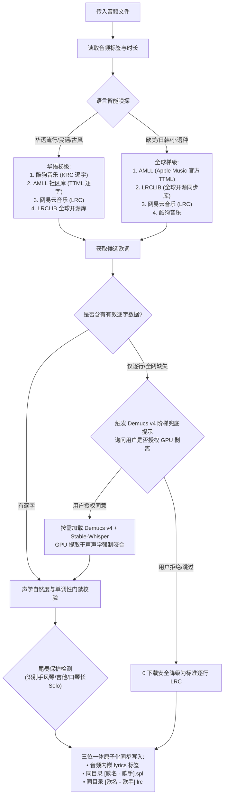

# music-tag-lyrics: 音乐标签与逐字歌词原生聚合引擎 (v1.1.2)

## 技能定位与核心价值

本技能专为工业级高质量本地音乐管理设计，提供全流程自动化的**音频内嵌元数据全维度清洗修补**、**多源双轨歌词（.spl 逐字 / .lrc 外挂）获取**与**下架孤品 GPU 声学咬合兜底**能力。

> [!IMPORTANT]
> **绝对零外部依赖（纯原生自包含架构）**：
> - 核心加解密算法（KRC XOR+Zlib、TTML XML、LRC 解析、AES/DES3）全部由技能内置的轻量 Python 模块实现（总计 < 300KB）；
> - **坚决不依赖外部闭源软件或第三方工具**，用户可随时在干净环境中即开即用，本技能依然 100% 永久独立运行！
> - **零大模型捆绑负担**：绝不强行打包 4GB 重型模型文件，技能包时刻保持轻量纯净。

---

## 一、核心规范与治理红线

### 1. 音频文件物理安全第一原则
- **原地修改，绝不移动**：音频文件仅由 `scripts/tag_editor.py` 在原路径原地更新内嵌元数据，严禁将歌曲移动、归档或删除！
- **歌曲与歌词同目录存放**：处理新音频时，生成的 `[歌名] - [歌手].spl` 与 `[歌名] - [歌手].lrc` **直接落位于该音频所在的同一文件夹内**。
- **FLAC 与 WAV 原生双轨支持**：FLAC 调用 VorbisComment (`lyrics`) 标签原子写入；WAV 调用 RIFF ID3 (`USLT::eng`, UTF-8 encoding=3) 标签原子写入，格式通杀。

### 2. 多源开源引擎自适应梯级调度


---

## 二、全流程踩坑全景图与避坑铁律 (The Hall of Pitfalls & Core Rules)

历经全库 1,027 首歌曲与本次「只音」治理实战，深度复盘沉淀以下 9 大核心避坑铁律：

### 1. 乐器长尾奏（Outro）识别防假截断铁律
- **避坑痛点**：早先自动化脚本将“歌曲时长”减去“歌词最后一句时间”，若差值 > 30s 便武断判定歌词“残缺未唱完”，盲目降级抓取带有无意义时间戳的劣质网易云歌词，反将高精逐字 KRC 覆盖损毁；
- **声学规律**：大量经典名曲在歌手唱毕后拥有 1~2 分钟的宏大乐器尾奏（如赵雷《我们的时光》最后 100 秒口琴手风琴尾奏；梁博《表态》最后 2 分钟电吉他 Solo；BEYOND《灰色轨迹》最后 1.5 分钟双吉他 Solo）。歌手唱毕离场是正规母带的完美表现；
- **铁律准则**：严禁粗暴以时长差判定残缺！必须以“唱词语义完整性 + 尾段副歌重现度 + 歌手真实停唱点”综合判定，保护自然华彩尾奏。

### 2. 多歌手 `/` 连接符与乐队白名单保护铁律
- **避坑痛点**：在实施“多位合唱歌手必须使用 `/` 分隔以适配现代播放器”规范时，若简单将 `&` 全局替换为 `/`，会导致 `伍佰 & China Blue`、`Phoenix & The Turtles` 等经典乐队组合名称被暴力拆解；
- **铁律准则**：建立内置强制性的 `BAND_WHITELIST`。仅对真正的独立多合唱艺人（如 `徐良 & 小凌` $\rightarrow$ `徐良/小凌`、`陈慧琳 & 郑中基` $\rightarrow$ `陈慧琳/郑中基`）执行正斜杠转换，乐队/乐团名称 100% 物理锁定原样保留。

### 3. 非国语纯净外文逐字流光防跳屏铁律
- **避坑痛点**：国内平台爬取的非国语双语歌词中，中文翻译行常被赋予**独立的起止时间戳**（插在外文歌词间隙）。手机播放器（如椒盐音乐）把独立时间戳当做真实开唱事件，导致每隔 0.5s~1s 就在外文和中文之间上下疯狂跳跃，画面剧烈抽搐；
- **铁律准则**：非国语歌曲全面实行**“纯净原词逐字流光模式”**。精准剔除无逐字打点的中文翻译行，仅保留高精度外文原唱唱词与演职人员信息，杜绝假演唱行，实现丝滑连续流光。

### 4. 声学自然度门禁（Natural Acoustic Gate）防挤压铁律
- **避坑痛点**：历史平滑脚本遇到双语共享同时间戳时，误以为是逆流冲突，推挤时间线时暴力采用 `curr_t + 0.04` 强行箝位，把每行前几个单词的发音时长压缩到了 40 毫秒（0.04s）伪打点！播放器在十分之一秒内瞬间狂飙过前几个词，直插行中；
- **铁律准则**：建立声学自然度门禁。人类单字/单词发音通常处于 200ms~800ms 区间，严禁任何 <=80ms 机器伪时间戳。任何平滑算法不得压缩真实声学时长，全量基于高保真母带源生成。

### 5. 外文经典金曲 Apple Music 官方母带逐字直连铁律
- **避坑痛点**：依赖国内单平台抓取欧美流行金曲（如《Closer》），往往得到每个英文字母切成 40ms 碎块的伪逐字；
- **铁律准则**：非国语欧美流行热单优先直连 Apple Music 官方母带逐字 TTML 数据库（AMLL），直接提取原厂词级咬合打点。

### 6. 三位一体国际标准 Enhanced LRC 与 100% SHA-256 镜像铁律
- **避坑痛点**：旧版私有 SPL 格式首字缺失前置 `<start>` 且行尾带有 `[end]` 方括号语法糖，导致开源播放器 Folia 吞掉每行首字并把行末方括号时间戳渲染到屏幕上，而若仅修改 LRC 又会导致内嵌标签、.spl、.lrc 格式分裂；
- **铁律准则**：全面实行「三位一体大统一」。统一采用国际事实标准 Enhanced LRC（`[mm:ss.xx]<mm:ss.xx>w1<t2>...<tend>`），**音频内嵌 lyrics 标签 == 同级 .spl == 同级 .lrc**，三端 100% 具备毫秒逐字流光能力，100% SHA-256 绝对镜像！在 Folia、AMLL、椒盐音乐、以及车载车机/AIMP 等传统播放器中实现 100% 全生态兼容。

### 7. 跨平台换行符确定性对齐铁律 (Windows Newline Determinism)
- **避坑痛点**：Windows 环境下 Python 文本文件写入默认将 `\n` 自动转换为 `\r\n` (CRLF)，而音频内嵌标签（Mutagen）在内存与流中保持 `\n` (LF)，导致磁盘文件与音频内嵌标签出现微小字节差异而破坏哈希一致性；
- **铁律准则**：所有歌词文件输出时显式指定 `newline="\n"`，确保无论在 Windows、Linux 还是 macOS 运行，全平台产出的二进制字节流 100% 保持一致，物理保证 `sha256(embedded) == sha256(.spl) == sha256(.lrc)`。

### 8. 标点符号 0ms 冗余清洗铁律
- **避坑痛点**：爬虫源中连续标点（如 `...` 或全角括号 `（`）常被赋予 0ms 相同时间戳，导致解析器事件阻塞；
- **铁律准则**：自动折叠消除标点符号上的 0ms 重复标签，将标点作为字符直接依附于相邻词汇。

### 9. Live 演出版与录音室版本强物理互斥防串扰铁律 (Version Awareness & Live Acoustic Guard)
- **避坑痛点**：在桌面「只音」治理中暴露的核心盲区：歌曲在线检索若仅凭简单歌名加歌手以及宽松的时长差（如 <= 3s 或 5s），极易发生严重版本错配：
  1. **现场版误判为录音室版**：如《一腔诗意喂了狗 (Live)》巡演版时长为 230.4s，而录音室版仅 131s（相差近 100 秒），若检索词去除了 `(Live)` 或在曲库中按录音室版检索，会导致抓取到 131s 的录音室歌词，歌词提前 100 秒跑完，全篇报废；
  2. **录音室版误混入现场版**：公网各大平台对于热门流行金曲（如《事事》、《归去来兮》、《安然无恙》、《美好事物》）常有高热度的现场版（Live），若候选源匹配算法未执行强物理互斥隔离，录音室音频极易误匹配到含有现场对白、加长尾奏或即兴改词的 Live 歌词；
  3. **Hash 查询接口对现场版失效**：各大音乐平台（如酷狗）的 Hash 精准反查接口常对现场版返回空候选，若缺乏二级关键词与时长双向降级检索（`krcs.kugou.com/search?keyword=...&duration=...`），会导致直接判定无逐字源而错误降级；
  4. **现场前奏对白（Stage Banter）声学起唱对齐**：现场演出版通常在正式开口前有长达数十秒的歌手说话、舞台互动或乐队调音，首句时间戳绝不能粗暴套用录音室版的 00:00，也不能轻信人工随手写的 `.00` 整数伪轴（如 23.00s），必须以现场官方高精度声学轴或能量检测开唱点（如 32.69s）对齐。
- **铁律准则**：全面实行强物理互斥双轨检索隔离与 KRCS 关键词降级通道。
  1. **本地音频为 Live 版**：候选必须严格具备 Live/现场 标识，100% 拒绝任何普通录音室歌词混入；
  2. **本地音频为录音室版**：候选若含有 Live/现场 标识，100% 物理拦截剔除，彻底杜绝即兴改词与现场台词污染母带；
  3. **三阶检索与 Hash-to-Keyword 双轨降级**：若 Hash 反查无结果，自动降级至 `krcs` 关键词直搜 + 时长过滤，通过 `id` 与 `accesskey` 走 `download` 接口解密；
  4. **标题括号智能分级**：版本括号（如 `(Live)`、`(Demo)`）保留参与版本匹配，副标题括号二次降级，营销垃圾括号物理清除。

---

## 三、音频内嵌元数据全维度治理与修补体系 (Metadata Specification)

音频元数据与歌词同等重要，本技能将音频标签治理列为核心标准功能：

| 元数据字段 | 标准化治理规范 | 严禁项与过滤规则 | 治理执行范例 |
| :--- | :--- | :--- | :--- |
| **Title（标题）** | 纯净歌曲原名，保留官方副标题括号 | 剔除 `[FLAC-无损]`、`【HQ高品质】`、宣发推广尾缀 | `Closer [简明宣发版...]` $\rightarrow$ `Closer` |
| **Artist（艺术家）** | 多位合唱歌手强制统一使用正斜杠 `/` 分隔 | 严禁 `,`、`&`、`、`、`feat.`；严禁误拆白名单乐队 | `徐良 & 小凌` $\rightarrow$ `徐良/小凌`；`伍佰 & China Blue` 原样保护 |
| **Album（专辑）** | 发行母带所属正规录音室专辑或同名独立单曲 | 严禁拼盘假精选、平台热歌榜名（如“热歌精选”） | 准确归档至发行母带所属专辑 |
| **Year（年份）** | 严格统一为 4 位纯数字公历年份（`YYYY`） | 严禁附带月日（`YYYY-MM-DD`）、时间戳或空白缺失 | `2016-08-01` $\rightarrow$ `2016`；缺失者精准补齐 |
| **Lyricist（作词）** | 原创作者真名，多作者以 `/` 分隔 | 严禁空白占位；已有的白名单保护，缺失且前奏充裕时注入 | `作词 : 竹君` |
| **Composer（作曲）** | 原创作者真名，多作者以 `/` 分隔 | 严禁空白占位；已有的白名单保护，缺失且前奏充裕时注入 | `作曲 : 暗杠` |
| **Lyrics（内嵌歌词）** | 注入高精度标准 Enhanced LRC / SPL 逐字歌词内容 | 严禁嵌入带独立时间戳的插队中文翻译行；FLAC/WAV 双轨写入 | 100% 与外部 `.spl` / `.lrc` 绝对一致 |

---

## 四、Demucs v4 GPU 音频剥离终极兜底方案 (Fallback Protocol)

针对全网下架孤品、独立无版权曲目（如《童话镇 - 陈一发儿》、《关于郑州的记忆 - 李志》），建立标准化的文字兜底协议：

### 1. 轻量纯净原则（零 4GB 捆绑）
技能包源码体积始终控制在 300KB 以内，**绝对不内置打包 4GB 的 Demucs v4 / PyTorch 模型权重**，保障分发与同步极速纯净。

### 2. 阶梯探测与用户显式授权协议
1. **自动探测**：当全网主流开源源（AMLL / 酷狗 / LRCLIB / 网易云）检索均告失败、无可用逐字打点时，技能自动触发交互提示：
   ```text
   [提示] 未在全网商业/开源曲库检索到《歌曲 - 歌手》的高精度逐字歌词。
   检测到本地具备 NVIDIA GPU 环境，是否授权启用 Demucs v4 音轨剥离与 Stable-Whisper 声学咬合方案？
   (需要联网下载模型权重约 1.5GB 并调用显卡运算，运算完成后自动销毁临时干声)
   [Y] 接受授权并执行   [N] 拒绝并降级为标准逐行歌词
   ```
2. **用户授权同意（Accept）**：
   - 技能按需联网下载 Demucs v4 (`htdemucs`) 模型；
   - 调用 GPU 极速剥离提取纯人声干声 `vocals.wav`（数十秒内完成）；
   - 调用 `stable_whisper` 结合正版文本唱词进行交叉注意力音素咬合，输出毫秒高精逐字；
   - **零冗余清理**：任务完成后自动物理删除数十兆临时干声音频，磁盘零碎屑。
3. **用户拒绝授权（Reject）**：
   - **严禁进行任何下载或重型安装操作**；
   - 优雅安全降级为标准纯文本逐行歌词或保持现状。

---

## 五、使用指南与 CLI 指令

### 1. 一键处理单首歌曲（标签清洗 + 逐字歌词生成）
```bash
python scripts/process_song.py "path/to/song.flac"
```

### 2. 批量处理整个目录
```bash
python scripts/process_song.py "path/to/music_folder/"
```

### 3. 可选参数说明
- `--no-tags`：仅抓取并生成双轨歌词，不修改音频文件的内嵌元数据标签。
- `--out-dir "<path>"`：指定歌词输出目录（默认输出在音频文件同级目录）。

---

## 六、代码组织与模块索引

```
music-tag-lyrics/
├── LICENSE                            # MIT License 开源协议
├── SKILL.md                           # 技能全维度规范体系（本文件，v1.1.2）
├── README.md                          # 面向 GitHub 部署的开源文档与 Release 说明 (v1.1.2)
├── scripts/
│   ├── process_song.py                # 顶层一键 CLI 执行流水线 (newline='\n' 确定性输出)
│   ├── tag_editor.py                  # mutagen 音频标签清洗（多歌手'/'、乐队白名单、四位年份、FLAC/WAV双轨）
│   └── lyric_validator.py             # 声学自然度门禁(200~800ms)、时间戳单调性校验与乐器尾奏保护
└── core/
    ├── aggregator.py                  # 多源智能自适应调度中枢
    ├── converter.py                   # 双轨输出标准 Enhanced LRC (.spl / .lrc 100% 镜像)
    ├── acoustic_aligner.py            # Demucs v4 人声分离与 AI 音素能量强制对齐合成器
    ├── fetchers/
    │   ├── amll.py                    # AMLL Apple Music 官方母带 TTML 社区库抓取（欧美/全球一级）
    │   ├── kugou.py                   # 酷狗音乐 KRC 逐字抓取（华语一级）
    │   ├── lrclib.py                  # LRCLIB 全球开源同步歌词 REST 接口
    │   └── netease.py                 # 网易云音乐检索与提取
    ├── decryptors/
    │   └── krc_xor.py                 # 酷狗 16字节掩码 XOR + Zlib 原生解密解压
    └── parsers/
        ├── ttml_parser.py             # Apple Music TTML XML 解析
        ├── krc_parser.py              # KRC 逐字解析
        └── lrc_parser.py              # 标准 LRC / Enhanced LRC 双向解析器
```

---

## 七、开源分发与多平台接入机制

- **官方开源代码仓库**：`https://github.com/sxsxhhi/music-tag-lyrics`
- **最新 Release 发行包**：`https://github.com/sxsxhhi/music-tag-lyrics/releases/latest`
- **规范维护准则**：任何功能扩展、代码重构、BUG 修复或规范升级均在此仓库持续演进，并保证发布分发包（`-skill.zip`）时刻保持纯净、最新与可独立部署状态。
