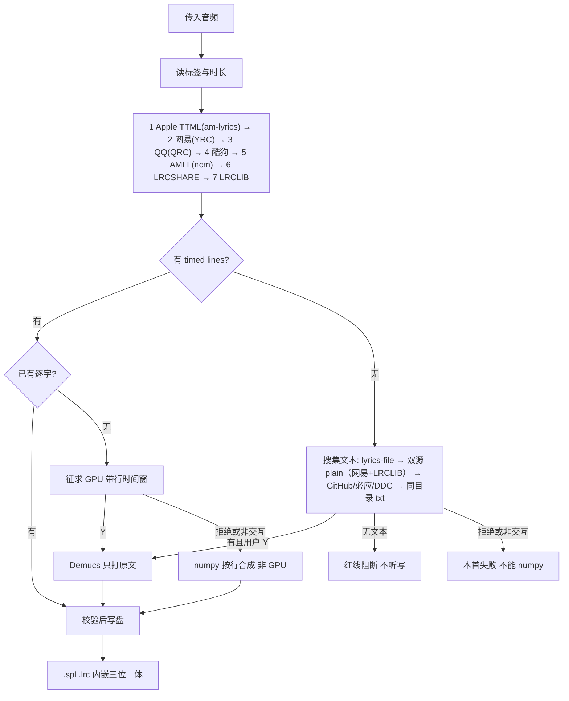

# music-tag-lyrics: 音乐标签与逐字歌词原生聚合引擎 (v1.8.4)

纯 Python 技能：原地洗标签、多源抓词、同目录写出 `.spl` / `.lrc`。缺标题/歌手按文件名「歌名-歌手」补全；作词/作曲仅在空时从歌词署名行提取。Python 侧需 `mutagen`；`numpy` 仅在拒绝 GPU / 非交互时用于行级合成；Demucs GPU 为精度优先的可选兜底。抓词失败仍可只写清洗后的元数据。

> **不依赖 ffmpeg / Node / 播放器。** 绝不移动、归档或删除音频。`--lyrics-only` 只覆写内嵌歌词帧。**【环境与存储红线】默认不主动向系统盘写入缓存。** 模型缓存默认指向 `HF_HOME` 指定的非系统盘路径；应用缓存按五级回退，回退时输出一次性告警；需要确定契约时显式启用 `MTL_STRICT_STORAGE=1`（缺/相对/不可写即报错，不回退）。

---

## 一、调度与写盘



- **Apple TTML 升为第 1 档（v1.3.0）**：所有曲目优先通过本地索引（`am-lyrics/index.jsonl`，2,745 行折叠聚合为 1,773 组）与 iTunes 实时检索（search 四区 hk/tw/us/jp；lookup 华语 us→cn、外语 us→jp）发现 Apple ID；多镜像按 origin 攒票回退拉取 TTML；iTunes 令牌桶 24 容量 / 1.6 每秒，耗尽时打印可见降级日志。
- **华语 Strict 门禁防串歌（D4）**：华语曲目必须严格通过标题严格相等、艺人交集、版本互斥、时长证据（E1 iTunes trackTimeMillis 对齐或 E2 专辑+E3b 吻合），才允许作为 strict 候选覆盖酷狗；任何 loose 华语一律返回空平滑落入酷狗。
- **外语单调等级替换（D5 / D6）**：原文与译文必须同一源、同一版。后序源必须具备严格更高等级（`_rank`：逐字+译文(3) > 行级+译文(2) > 逐字无译文(1) > 行级无译文(0)）才能整包替换前置源；外语缺译文的 Apple 逐字允许被后续带官方译文的网易/LRCSHARE 整包替换。
- Demucs **不是第七个抓词 API**。有行无字：精度优先问 GPU（`line_timing_hints`）；拒绝/非交互才 numpy。无 `lines`：先全球搜权威文本（GitHub/raw 优先），再问 GPU；拒绝不能 numpy。
- `--non-interactive`：有行轴则直接 numpy；无行轴则跳过 GPU，本首失败。
- **专辑封面补全（v1.3.2）**：默认写标签路径生效；已有内嵌封面 100% 物理跳过绝不覆盖；详见第三节封面规范。
- 回滚与开关：支持 `--no-apple-ttml`、`--no-cover` 与环境变量 `MTL_APPLE_TIER=off`。

安装与 CLI 见 `README.md`。

---

## 二、21 条避坑铁律

### 1. 乐器长尾奏（Outro）识别防假截断铁律
- **铁律准则**：严禁粗暴以时长差判定残缺。必须以唱词语义完整性、尾段副歌重现度、歌手真实停唱点综合判定，保护自然华彩尾奏。
- **解析口径**：末行结束早于曲终 = 尾奏，**不得拒绝**。只拒预览截断（曲长 >90s 且末行 <45s）和末行冲过曲终 +8s。

### 2. 多歌手 `/` 连接符与乐队白名单保护铁律
- **铁律准则**：`BAND_WHITELIST` 锁定乐队名。仅对真正的独立多合唱艺人把 `&` 等改为 `/`。

### 3. 非国语标准 ELRC 动态流光与防跳屏铁律
- **铁律准则**：
  1. 译文副行必须继承对应原唱行的行级时间戳（与铁律 6 同一精度：源 3 位则 `[mm:ss.xxx]`，否则 `[mm:ss.xx]`），紧随其下；
  2. 副行纯文本，严禁 `<>` 逐字；合成或 GPU 打轴都**只给原文写 `words`**；
  3. 无官方译文则保持纯原文（协同 Rule 13）。

### 4. 声学自然度门禁防挤压铁律
- **铁律准则**：人类单字/单词通常 200ms~800ms。严禁 <80ms 机器伪时间戳。平滑算法不得压缩真实声学时长。
- **实现口径**：当前在 `lyric_validator.check_acoustic_naturalness` 里告警（tiny 占比 >15% 时打印），不拒绝、不丢弃候选。校验修复的时长下限为 100ms，与告警阈值 80ms 错开。

### 5. 外文经典金曲 Apple Music 官方母带逐字直连铁律
- **铁律准则（v1.3.0 重构）**：Apple TTML 升为调度第 1 档（`am-lyrics/{appleId}.ttml`）。
- **实际调度（v1.7.0 七档）**：Apple TTML → 网易（YRC）→ QQ（QRC）→ 酷狗 → AMLL → LRCSHARE → LRCLIB。华语只认 `strict` 门槛；外语 `strict` / `loose` 均可；执行**等级单调（D6）**原则，彻底消除无条件降级顶替。
- **need_more 判据（v1.7.0 关键变更）**：从「有候选即停」改成「**非逐字就继续**」。否则网易（T2）返回行级后会立刻锁死，永远探不到 QQ（T3）的逐字。外语仍保留「逐字但缺译文时继续」的旧策略。
- **QQ 只交逐字**：QRC 解出是行级时直接返回 None，不污染逐字档；不消费接口的 `trans`/`roma`（未验证，避免假译文）。`MTL_QQ_TIER=off` 可整档停用。

### 6. 三位一体国际标准 Enhanced LRC 与 100% SHA-256 镜像铁律
- **铁律准则**：内嵌 lyrics == 同级 `.spl` == 同级 `.lrc`，统一 Enhanced LRC：`[mm:ss.xxx]<mm:ss.xxx>w1<t2>...<tend>`。
- **精度自适应**：源时间戳是 3 位毫秒就输出 3 位，源只有 1–2 位才退回 2 位（`[mm:ss.xx]`）。TTML 原生输出 3 位毫秒精度。

### 7. 跨平台换行符确定性对齐铁律
- **铁律准则**：歌词文件写入显式 `newline="\n"`，保证 `sha256(embedded) == sha256(.spl) == sha256(.lrc)`。

### 8. 标点符号 0ms 冗余清洗铁律
- **铁律准则**：折叠 0ms 重复标点时间戳，标点依附相邻词。

### 9. Live 演出版与录音室版本强物理互斥防串扰铁律
- **铁律准则**：
  1. 本地 Live：候选必须带 Live/现场，拒绝录音室词；
  2. 本地录音室：拦截含 Live/现场 的候选；
  3. Hash 无果则 KRCS 关键词 + 时长降级；
  4. 版本括号参与匹配，营销垃圾括号清除；
  5. 互斥覆盖七源 API（其中 plain 检索为双源：网易+LRCLIB）、全球纯文本、自动同目录 txt；`--lyrics-file` 用户明示则不拦。
  6. KRCS 标题无 Live、专辑为空时：候选时长与本地 Live **±10s** 视为同版本，放行。
  7. **Remix/混音双向互斥（v1.3.5 固化）**：`REMIX_PATTERN` 识别 remix / re-mix / 混音 / 括号内 club·extended·radio edit /「xxx mix」；本地混音版必须命中混音候选，本地原版拦截混音候选。已在**酷狗、网易、LRCLIB 三链路**启用（`matches_version_policy` 的 `target_is_remix` 可选参，向后兼容），LRCSHARE 沿用旧签名。
  8. **同名专辑加权（v1.3.5 固化，三源共用）**：候选排序中同名专辑（去括号精确相等 +60 / 互为子串 +30，`version_guard.album_match_score` 单一出处；**极短专辑名 <3 字符只允许精确相等防数字穿透**）优先于时长抖动；**调度层必须向酷狗/网易透传 album**（漏传曾致错配混音版专辑，e9/e10 回归测试锁定）。

### 10. 全链路 [offset] / adjust 叠加与前奏异常门禁铁律
- **铁律准则**：
  1. 解析行/字时间戳强制 `total_offset = offset + adjust`，`>= 0` 箝位；
  2. LRC 多时间戳行逐个保留，0 丢行；分钟位支持 1–3 位（`[123:45.67]` 不被静默丢弃）；
  3. 常规曲（>90s）首句非报幕起唱 >32s 发出 Intro Gate 警告。

### 11. 【核心红线】绝不语音听写，必须先检后轴铁律
- **铁律准则**：**严禁 ASR 盲目听写。精度优先。**
  1. 有逐行、无逐字：先征求 GPU（把行轴当作 `line_timing_hints` 短窗）；拒绝 / `--non-interactive` / GPU 失败才 numpy 按行合成；
  2. 无 timed lines：先搜集权威文本（`--lyrics-file` → 双源 plain（网易+LRCLIB） → GitHub/raw 优先再必应/DuckDuckGo → 同目录 txt），再征求 GPU；无文本立即阻断。此分支拒绝不能 numpy；
  3. Whisper 只做 Forced Alignment，不得改词。合成或 GPU 都只给原文写 `words`。

### 12. 双端声学能量门禁与间隙防拉伸铁律
- **铁律准则**：短窗隔离 ≥2.5s 间奏；行首 15ms 逆向 Onset；行末 20ms 正向 Offset（RMS < 0.015）；字间停顿 ≥300ms 插入闭合标签。

### 13. 【核心红线】绝不机械机翻铁律
- **铁律准则**：**禁止机翻补译文。** 只采纳官方/人工审校文本（网易 `tlyric` / 与逐字同轴的 `ytlrc` 等）。无官方译文则纯原文。译文必须与原文同一源同一版。

### 14. 外文词界空格与 `\xa0` 消融铁律
- **铁律准则**：西文词间保留 ASCII 空格；全流程 `replace('\xa0', ' ')`；标点紧随词末。

### 15. 【核心红线】酷狗 KRC 语义翻译与音译防混淆硬门禁
- **铁律准则**：仅 `type == 1` 且通过汉字检测才算译文；丢弃 `type: 0` 罗马音/假名。

### 16. 【核心红线】纯音乐占位防篡改与有效行数门禁
- **铁律准则**：
  1. 含「纯音乐 / 伴奏 / Instrumental / No Lyrics」等占位则拒绝（`core/utils/text_utils.py`）；
  2. 译文行数低于 `max(4, 0.3 × 原词行数)` 熔断；
  3. 结构门对 Apple TTML 强制要求至少包含 1 行逐字时间戳。

### 17. 【核心红线】物理时长严密邻近与版本防串扰门禁
- **搜歌元数据容差（分源，不可统一）**：酷狗 **±10s**；网易/LRCLIB 搜索元数据 **±35s**；Apple TTML 要求 E3a 与 E3b_floor（axis/local ≥ 0.50）必过，再加上 E1（`trackTimeMillis` ±5s）或 E2 专辑吻合 + E3b_strict。
- **解析末行（各源同一套）**：只拒「曲 >90s 且末行 <45s」预览，以及「末行超过曲终 +8s」冲轴。**禁止**用「解析末行 ±N s」整份剔除（那会把器乐尾奏当残缺）。
- **Apple TTML `<body dur>`**：歌词轴长非音频总长，禁止对 `<body dur>` 做对称容差比较；`country=cn` 仅在 Lookup 有效，Search 永不碰 cn。

### 18. 【核心红线】黄金基准时间轴锚定与动态微调门禁
- **铁律准则**：
  1. 主行 start/end/words 不可被译文改写；
  2. aggregator 译文挂载窗口为 **1500ms 最近邻**；
  3. 外语缺译文时用同一源整包替换，禁止跨源把 tlyric 挂到酷狗轴上。

### 19. 【核心红线】行间绝对单向零重叠门禁铁律
- **铁律准则**：全曲歌词时间轴必须严格单向单调推进。任意歌词行必须满足 start(i+1) ≥ end(i) + 50ms，严禁产生任何时间重叠交错。声学切片、谷底搜索与和声延展均严禁侵占下一行的起振间隙（validator 零重叠防御自动缩拢前句，行长下限 500ms、单字下限 100ms）。

### 20. 【核心红线】声学真逐字硬门禁与伪对齐阻断铁律
- **铁律准则**：调用声学对齐模块（`AcousticAligner.align_lyrics`）时，严禁使用固定除法伪造逐字。运行环境必须具备可用 GPU（CUDA 就绪）与 `stable_whisper` 依赖，缺失时立即抛出 `AcousticEnvironmentError` 显式阻断，坚决杜绝低质假逐字输出。仅在用户明确拒绝 GPU 时，才允许在外部降级分支进入 numpy 行级合成——此路径 `synthesized_words=True`，控制台明确提示「非酷狗逐字、非 GPU」。
- **记账语义（v1.5.2）**：`synthesized_words=True` 仅表示「整首没有任何真声学逐字」。两条声学路径都是真声学：粤语 CTC 逐字带分数（`gpu_acoustic`），普通话双引擎逐字是声学时间轴但引擎不产分数（`gpu_whisper`）——后者**不是**合成，不得因缺字段就标 True。该字段是内存记账（`words_source` / `acoustic_coverage` / `synthesized_ratio`），**不写进音频标签或 LRC 头**。
- **双引擎流水线（v1.4.0）**：`DualEngineHybridAligner` = Demucs 人声 → 行级提示窗 Whisper Token 对齐 → 44.1kHz STFT 谱流单字拆分/±60ms 瞬态吸附 → 25ms/5ms RMS 换气谷底双向锁定（释放门限 RMS≤0.020，仅作用于行间场景）→ sustain 衰减门控（60ms 静默收束）→ 双声回音覆盖（tail ≤ next_start − 50ms）。行级时间轴提示为一等先验输入。

### 21. 【核心红线】公开分发前必须脱敏（开发与发布纪律）
- **铁律准则**：本 skill 的源码、分发包、release 资产与任一 tag 源码树都属于**公开面**。推送、打 tag、上传资产之前必须确认其中不含本机环境信息与私人数据。历史上曾发生 release 资产与全部历史 tag 同时泄漏本机路径、私人曲库清单与完整版权歌词的事故，代价是重建全部资产与标签入口。
- **强制命令**（退出码非 0 一律不得推送）：仓库扫描 `python scripts/check_no_leaks.py`；发布包扫描 `python scripts/check_no_leaks.py --zip <包路径>`。仓库已配置 `core.hooksPath=scripts/git-hooks`，`pre-push` 自动执行；用 `--no-verify` 绕过视为违规。
- **禁止进入公开面**：带盘符的本机绝对路径、Windows 用户名、真实邮箱、私有数据目录名、私人曲库清单（曲名/艺人/指纹）、本机运行快照、内部审计与复盘报告、完整或近完整的歌词与真实接口密文。
- **写法规约**：路径一律使用 `MTL_*` 环境变量或 `<workspace>` / `<repo>` / `<hf-cache>` / `<user-home>` / `<mother-library>` / `<process-dir>` 占位符；运维脚本的硬编码目标路径改为环境变量注入或从仓库根相对推导；新增测试夹具必须是**结构等价的合成内容**——保留行数、字数、时间轴与解析断言，删除全部表达性文本。

### 运行纪律（丢弃必须说清）
- 源返回空时必须打印**丢弃原因**（预览 / 冲轴 / 版本互斥）。禁止对用户说「酷狗没有」，除非搜歌候选数为 0。
- Apple TTML 镜像不可达、404 未达共识（SUSPECT_MISSING）、未收录（NOT_FOUND）三种必须明确区分并记录日志。
- numpy 按行合成必须标明「非酷狗逐字、非 GPU」，禁止把合成轴说成酷狗逐字。

---

## 三、音频内嵌元数据治理

| 元数据字段 | 标准化治理规范 | 严禁项与过滤规则 | 治理执行范例 |
| :--- | :--- | :--- | :--- |
| **Title（标题）** | 纯净歌曲原名，保留官方副标题与 `(Live)` | 剔除 `[FLAC-无损]`、`【HQ高品质】`、宣发尾缀；已有标题不覆盖 | 缺标题时 `广场-李志.flac` → `广场`；`起风了 (Live)-歌手` 保留 Live |
| **Artist（艺术家）** | 多合唱强制 `/`；缺歌手按文件名补全 | 严禁误拆白名单乐队；白名单命中仍保留 Live 后缀 | `徐良 & 小凌` → `徐良/小凌`；`Earth, Wind & Fire (Live)` 原样 |
| **Album（专辑）** | 原样回写 | 空则跳过，不覆盖原值 | 不查发行专辑、不拦热歌榜 |
| **Year（年份）** | 4 位公历 `YYYY`；空或等于当年日历年时从专辑名四位数字、再网易 `publishTime` 补 | 解析不出则不写；严禁把「今天」写成发行年 | `2016-08-01` → `2016`；专辑 `2018 (上)` → `2018` |
| **Lyricist / Composer** | 仅空时从歌词署名行提取 | 已有不覆盖；`--lyrics-only` 不写这两项 | `作词 : 方文山` → TEXT；`词不达意` 不提取 |
| **Lyrics（内嵌歌词）** | Enhanced LRC，与 `.spl`/`.lrc` 镜像；写入时删除全部 `USLT*`/`SYLT*`，只留一帧 | 译文不得独立时间戳插队；禁止逐行+逐字并存 | FLAC/WAV/MP3/M4A/OGG/DSF |
| **Album Cover（专辑封面）** | 缺失时网络三级梯级补全：iTunes 顺风车（lookup/search 缓存里的 `artworkUrl100`，`100x100bb`→`1000x1000bb` 取原图）→ 网易 `song/detail` 的 `album.picUrl` → 酷狗 `album/info` 的 `imgurl` | **已有内嵌封面 100% 跳过绝不覆盖**；JPEG/PNG 魔数 + ≥1KB 硬校验，坏图直接丢弃；与标签/歌词合并为**同一次落盘**；`--no-cover` 显式跳过；OGG 本轮不写（打日志跳过） | FLAC(Picture type=3) / MP3·WAV·DSF(APIC) / M4A·MP4(covr) |

---

## 四、Demucs v4 GPU 兜底与双引擎声学对齐 (v1.5.0)

技能包不内置重型模型权重。声学环境位于 `<acoustic-env>`，HuggingFace 缓存统一指向 `<hf-cache>/`（HF_HOME 固化，内含 HTDemucs / 粤语 / 国语权重，2.77GB，保留相对软链接）。严禁回写系统盘用户目录。两条入口：

1. **有行无字**：征求 GPU；Y 用已有行轴做短窗；N / 非交互 / 失败 → numpy 合成。
2. **无 lines**：先全球搜文本（GitHub 优先），再征求 GPU；无文本红线阻断；N / 非交互 → 本首失败。

**阻断（搜不到权威文本）：**

```text
🛑 [Demucs v4 绝对红线阻断 (v1.5.0)]
未能从商业曲库、全球检索与本地文件得到权威歌词文本。
⚠️ 核心铁律：【绝不语音听写】！可放置同目录 txt 或使用 --lyrics-file。
```

**双引擎声学调度架构（v1.5.0 原生收编）**：
- **语种自动探测路由（`core/utils/lang_detect.py`）**：Cantopop 白名单歌手库 + 粤语经典意象词表（40+ 词条）+ 俚语字频统计 + 未剥离音频首窗预探。CLI 可通过 `--lang auto/zh/yue` 强制指定。
- **国语/外语通用引擎（`DualEngineHybridAligner`）**：Demucs 人声分离 + Whisper Cross-Attention 行窗咬合 + 44.1kHz STFT 瞬态吸附 + RMS 换气谷底双向锁定 + sustain 衰减门控。
- **粤语专用引擎（`CantoneseCTCAligner`）**：Demucs 人声分离 + `wav2vec2-large-xlsr-cantonese` + 703 类无调粤拼 CTC 映射桥梁 + `torchaudio.functional.forced_align` Viterbi DP 强制对齐 + 入声韵尾（-p/-t/-k）120ms 闭气保护 + 西文单词等比内插 + 铁律 19 零重叠硬门禁。
- 外语只对齐原文，译文挂回 `translation`。有行无字时拒绝会降级合成；无行轴时拒绝不能合成。

---

## 五、模块入口

- CLI：`scripts/process_song.py`、`scripts/ttml2lyrics.py`（单曲诊断转换器）
- 标签：`scripts/tag_editor.py`
- 调度：`core/aggregator.py`（Apple TTML → 网易 → QQ → 酷狗 → AMLL → LRCSHARE → LRCLIB）
- 抓取：`core/fetchers/`（`apple_ttml.py`、`netease.py`、`qq.py`、`kugou.py`、`amll.py`、`lrcshare.py`、`lrclib.py`、`itunes_client.py`、`cover_art.py`）
- 声学对齐（双引擎）：`core/acoustic_aligner.py`（调度与普通话 Whisper 双引擎流水线）、`core/acoustic_canto.py`（粤语 CTC 对齐引擎）
- 语种路由：`core/utils/lang_detect.py`（歌手/意象/俚语/首窗声学探针）
- 粤拼转换：`core/utils/jyutping.py`、`core/data/jyutping_dict.tsv`（简繁离线词典与多音字前缀消歧）
- 纯文本搜集：`core/plain_lyric_search.py`（双源 plain：网易+LRCLIB，+ GitHub/raw + 必应/DDG）
- 解析：`core/parsers/`（`lrc_parser.py`、`ttml_parser.py`、`krc_parser.py`、`yrc_parser.py`、`qrc_parser.py`）
- 解密：`core/decryptors/`（`krc_xor.py`、`qrc_des.py`）
- 共享：`core/utils/`（http / time_utils / version_guard / text_utils / text_match / cache_paths / io_safe）
- 离线测：`python -B tests/run_all.py`（自动发现测试，**具体套件数/用例数以本次 `run_all.py` 实际输出为准**，本文件不写死数字以免再度过期；环境相关 SKIP 需单独报告）。⚠️ 本仓用例为函数式三态 runner，**不要**用 `unittest discover`（会输出 `NO TESTS RAN` 且退出码 0）。

仓库：`https://github.com/sxsxhhi/music-tag-lyrics`

## 六、声学对齐 v1.6.0：zh CTC 通道 / 行轴校准 / 质检闭环

**国语新通道（默认开启，`MTL_ZH_CTC=0` 回退双引擎）**：中文 wav2vec2 CTC **逐行窗**
强制对齐（每行独立窗，免疫全局漂移与「长字吞停顿」）。模型
`jonatasgrosman/wav2vec2-large-xlsr-53-chinese-zh-cn`（1.2GB）一律
`local_files_only` 加载，缺失即抛 `AcousticEnvironmentError`，**绝不静默联网**；
失败自动回落 Whisper 双引擎。词表只有大写 A–Z（无数字/标点）→ 英文走 `upper()`
回退、数字与标点吸附为 `no_ctc` 间隙词；**逐字只借时间，绝不改词**（断言兜底）。

**逐行闸（`core/acoustic/gate.py`）**：字宽软限 1200ms（字内停顿 ≥250ms 判「吞停顿」）、
硬限 1600ms（真实长音实测 1537ms 必须放行）、跨度 `max(2s, 字数×0.8s)`；
位移 >600ms 且非短句（≤2 字放行）时要求分数 >−9 且新起点 ±150ms 内有起振。
不合格**整行回退**（旧值优先，否则线性保底）并计入 `gate_reverts`。

**行轴校准（`core/utils/line_axis.py`，`MTL_LINE_AXIS=keep` 关闭）**：
行级 LRC 的行标签是「整行显示时间」（实测早 0.88s），逐字化后必须下沉到起唱点：
`tag = 首字 − 60ms`，三档裁决（收缩上一行末字 → 退到 0 间隙 → 整行后推 ≤99ms），
**绝不 `min(tag, first)` 硬压**（会造行间重叠）。TTML/KRC/官方逐字永不改写；
同时间戳译文行跟随主行位移。判定门：`−150ms ≤ tag − 首字 ≤ 0` 全量通过。

**质检闭环（`core/acoustic/qc.py`）**：`python -m core.acoustic.qc --lrc x.lrc --audio x.flac`
可独立跑（仅 numpy）；L1 单调自动修复（含 ≥50ms 短字）、L2 节奏只告警分诊、
L3 三窗复检需注入对齐回调。`--qc-report x.json` 输出 L1/L2/行轴/闸门汇总。

**zh 出货验货（`MTL_ZH_GATE=on`）**：原判粤语、熔断后由 zh 出货时，用**粤语** CTC
模型给 zh 跨度打分，中位数 < `MTL_ZH_MIN_SCORE`（−8.0）即拒收回落行级
（只做同曲横向比较，绝不跨模型设绝对阈值）。

**开关总表（全部可独立回退）**：`MTL_ALIGN_MODE=windowed|global`、`MTL_ZH_CTC=1|0`、
`MTL_ZH_GATE=on|off`、`MTL_ZH_MIN_SCORE=-8.0`、`MTL_LINE_AXIS=calibrate|keep`、
`MTL_DEVICE=auto|cpu`、`MTL_DEMUCS=on|off`、`MTL_QC_L3=on|off`、`MTL_GATE_MODE=strict|warn|off`。

## 七、网易 YRC 逐字通道（v1.6.1）

- **接口**：`/api/song/lyric?id=…&lv=1&kv=1&tv=-1&yv=1&rv=1`。只有 `yv=1` 才返回 `yrc`（逐字）；
  `ytlrc` 是逐字轨配套的行级译文，与 yrc 行戳同轴（实测最近邻 0ms），优先于 `tlyric`。
- **格式**：`[行起,行时长](字起,字时长,标志)字…`，**字时间是绝对毫秒**（KRC 是相对行偏移）。
- **解析**（`core/parsers/yrc_parser.py`）：
  1. **位置切片**取字文本：先定位所有 `(数字,数字,数字)`，相邻参数之间的原文才是字文本，
     `母带 : … (FR) …` 这类括号不会打断；
  2. 三类异常块归一 —— 空文本块丢弃（不延长末字）、纯空白块与零时长块并入前一字文本；
  3. 行 `start` 取首字、`end` 取末字，源头即满足 `start == words[0].start`、`end == words[-1].end`；
  4. `time_precision` 恒为 3（`detect_time_precision` 对 YRC 会误判为 2，必须显式给）。
- **尾部名单截断**：网易把制作名单按每行 1000ms 等距铺排到曲末之后（实测《那么骄傲(重遇版)》
  末行 268230ms / 曲长 245239ms），会触发七源统一 overrun 门禁而整包丢弃。
  只在「末行确实已冲轴」时，按「曲末 15% 内 + 连续 ≥3 行 + 每行 800~1200ms + 首尾相接」四重判据
  从尾部向前截断；识别失败一律返回空、回落 lrc，**绝不硬砍真实歌词**。
- **降级契约**：无 `yrc` / 解析 0 行 / 截断后不足 4 行 / 抛异常 → 回落原行级 lrc 路径，
  与升级前逐字节一致；`fetch` 参数表一个字都不加（保护显式关键字签名的调度假体）。
- **行轴**：`source="netease"` 且带词 → `official`（不参与 −60ms 校准）；网易的行级 lrc 候选仍为 `display`。
- **调度不变**：仍是第 4 档。华语酷狗/AMLL 已出逐字时 `rank 3 == 3`，`_adopt` 要求严格更高，
  故仍用酷狗；网易只在「前三档全空」「酷狗门禁丢弃」「外语缺译文」等场景真正生效。

**离线测试**：由 `tests/run_all.py` 自动发现，**以实际输出为准**（三态 runner，SKIP 不计）；
一键 `python tests/run_all.py`；`tests/audit_acoustic_baseline.py` 为 Golden **只读审计**
（跑引擎、逐行比对、出 diff 与初判，**禁止用引擎输出回填夹具**）。

---

## 八、环境隔离与存储红线（默认不主动写系统盘，可显式收紧）

- **【核心红线】默认不主动向系统盘写入缓存；需要确定契约时显式启用 `MTL_STRICT_STORAGE=1`**：
  1. **模型缓存与重型权重一律外置**：HuggingFace 缓存统一且唯一使用 `<workspace>/hf-cache`（通过环境变量 `HF_HOME` 固化）。严禁任何脚本、模型加载或测试代码向 `<user-home>/.cache/huggingface` 回写或重新创建目录；
  2. **禁止系统默认桌面路径**：`<user-home>/Desktop` 不作为任何输入或输出位置；需要桌面级目录时必须显式指定非系统盘数据目录；
  3. **声学虚拟环境规范**：仅使用 `<acoustic-env>/Scripts/python.exe -m …` 或直接导入；禁用 Scripts 内的 console `.exe` 垫片（因绝对路径已失效）；
  4. **工作区与母盘边界**：母盘 `<mother-library>/` 绝对只读；过程文件严禁散落根目录，一律进 `<process-dir>/`；测试曲库必须加 `--no-tags` 零污染。

## 九、QQ 音乐 QRC 逐字通道（v1.7.0）


### 1. 接口与链路
- 搜索：`https://c.y.qq.com/soso/fcgi-bin/search_for_qq_cp?w={歌名 歌手}&format=json&p=1&n=10`，
  **必须带 `Referer: https://y.qq.com/`**；返回 `data.song.list[]`，关键字段 `songid`（数字，歌词接口要用）、
  `songmid`、`songname`、`singer[].name`、`albumname`、`interval`（秒）。
- 歌词：`POST https://u.y.qq.com/cgi-bin/musicu.fcg`，body 是 **JSON**（不是 form-encoded），
  `req_0.method = GetPlayLyricInfo`、`req_0.module = music.musichallSong.PlayLyricInfo`，
  `param` 里 `crypt=1`、`qrc=1`、`songID` 必须是 int、歌名/专辑/歌手用 Base64(UTF-8)。
  返回 `req_0.data.lyric` 是 **hex 字符串**。
- 解密：hex → 3DES(ECB) → zlib → QRC 文本。

### 2. 3DES 位序陷阱（最容易踩的坑）
QQ 自带的 DES 实现**位号与标准 DES 不同**（PC1/PC2/IP/FP 下标都按它自己的 `bitnum()` 取位定义）。
实测 pycryptodome 的 `DES3.new()` 用 `K1K2K3` / `K3K2K1` / 单 DES 三种排列**全部解不出来**
（前 16 字节乱码），只有照抄那份 JS 实现才对得上。因此 `core/decryptors/qrc_des.py`
逐行移植了 SBOX / `bitnum` / `initialPermutation` / `inversePermutation` / `desF` / `keySchedule` / `cryptBlock`，
**不要用标准 DES 表替换**。密钥调度顺序：`D(K3) → E(K2) → D(K1)`，密钥 24 字节
`!@#)(*$%123ZXC!@!@#)(NHL`。

### 3. QRC 语义
- 明文是 **XML 包装**：`<QrcInfos>…<Lyric_1 LyricContent="[ti:…]&#10;[0,2250]晴(0,160)…"/>`，
  正文在 `LyricContent` 属性里，取出后要 `html.unescape`。
- 行头 `[行起ms,行时长ms]`；字块是 **「文本在前、参数在后」**：`晴(0,160)天(160,160)`。
  注意与网易 YRC 的 `(起,长,标志)字` 方向**相反**，切片要取「上一个参数结束 → 当前参数开始」之间的原文。
- **字时间是绝对毫秒**（与 YRC 同语义，不是 KRC 的相对偏移）。
- 解析后 `line.start == words[0].start`、`line.end == words[-1].end` 两条恒等式在源头成立。
- 实测 63 行 / 597 字，零重叠、零空字、零时长；字宽 p50 = 375ms。
- 质量对标：QQ《晴天》首字 29264ms，Apple TTML 29260ms，差 4ms。

### 4. 同曲判定（四项）
歌名模糊匹配 + 版本互斥 + 歌手有交集 + 时长 **±5s** 是硬闸；专辑用 `album_match_score` 加权排序（不作硬闸，
因为 QQ 候选常缺专辑名）。取前 3 个候选依次请求歌词。

> 搜索「晴天 周杰伦」第 2 条就是 `晴天 (Live)`，版本互斥是必需项而非可选项。

### 5. 只交逐字
QRC 解出来是行级（每行只有 1 个字块）时直接返回 `None`，**不返回行级候选**，交给下一个源。
不消费接口的 `trans` / `roma` 字段（未验证，避免凭空造译文）。
尾部若出现等距铺排的制作名单，复用 `yrc_parser.trim_tail_staff` 截断，识别失败返回 `None`，绝不硬砍正文。

### 6. 调度顺序变更（v1.7.0 破坏性变更）
| 版本 | 顺序 |
| :--- | :--- |
| v1.6.1 及以前 | Apple → 酷狗(T2) → AMLL(T3) → 网易(T4) → LRCSHARE → LRCLIB |
| **v1.7.0** | **Apple → 网易(T2) → QQ(T3) → 酷狗(T4) → AMLL(T5) → LRCSHARE(T6) → LRCLIB(T7)** |

配套改动：
- `need_more` 判据换成「非逐字就继续」，否则网易行级会锁死 QQ 逐字。
- 网易 T2 去掉 `elif attached` 守卫、LRCSHARE T6 去掉 `has_translation` 守卫，统一交给 `_rank` 的严格等级判定。
- `_rank` 公式不变：QQ 不设 `match`，逐字即 `word=1`，华语 rank 3 > 网易行级 rank 2，自动生效。
- `line_axis._WORD_LEVEL_SOURCES` 加 `qq`，其逐字判成 `official`，不会被 −60ms 校准。
- `MTL_QQ_TIER=off` 可整档停用。

### 7. 回归锁定
`tests/test_qq_qrc.py`（53 条）四组：A 解密 KAT（真实密文 SHA-256 + 块级往返 + 篡改必返空 + 性能 <2s）、
B 解析（绝对毫秒、括号不截断、零时长/空白块归一、XML 解包、converter 不降级、真实夹具 63 行 597 字）、
C fetcher（URL/body 形状、四项筛选、Live 互斥、行级拒收、双门禁、开关、签名锁）、
D 调度（七档顺序、网易行级→QQ 逐字、外语译文优先、LRCLIB 兜底、urlopen tripwire）。


---

## 十、lrc.red 全球开放同步网络与 ISRC 检索（v1.8.1 正确性强化版）

### 1. 架构定位与网络预算
在 T1 Apple TTML 体系内部接入 `lrc.red` 全球开放同步网络作为第二代 Apple 逐字流光歌词引擎：
- **优先通道**：先查 AMLL 静态镜像（`amll-ttml-db`）；
- **二级无缝兜底**：当 AMLL 404、未收录或华语非 strict 候选时，自动无缝平滑切入 `lrc.red`，对聚合器调用层透明；
- **全链路总预算**：共享 T1 14.0s 总超时预算（AMLL 最长占用 8.5s），lrc.red 单曲内部预算 5.0s，单次请求超时 3.0s，速率限制 1 req/s；
- **体积与端点兜底**：JSON 限制 1MB、TTML 限制 2MB 防 OOM；当 `.song.json` 404 时自动回退至公开 `.json` 与 `.ttml` 静态端点。

### 2. 缓存隔离与元数据严防假认证（P0 级铁律）
- **缓存双层解耦**：拆分远端原始网络响应记录（`_raw_cache`）与本地单曲上下文仲裁，彻底根除跨歌缓存串歌污染与偶发负缓存死锁；
- **严禁本地回填**：远端响应若缺失艺人或标题，一律显式标为 missing 并降级为 loose 候选，严禁使用本地音频标签自我认证；
- **版本互斥与门禁**：直查与搜索全链路统一部署版本互斥（Live/Remix/Medley 严格互斥）与时长硬闸（直查 ±5000ms，回写 ±3000ms）。

### 3. byModel 歌词隔离与逐字质量审计
- **模型歌词绝不冒充官方**：明确识别 `byModel=True` 模型生成歌词，禁止作为 T1 strict 官方原版交付，严禁作为 ISRC 回写凭证；
- **逐字质量审计**：TTML 解析计算有效逐字覆盖率（必须 ≥ 0.95），过滤单字假逐字；
- **TTML 格式规范**：完整支持 XML 实体反转义、多 div 真实时序自愈重排、英文单词自然空格连接及时间标签规范化。

### 4. ISRC 跨格式读取与受控安全回写（--write-isrc）
- **读取支持**：FLAC/OGG (`isrc`)、MP3/ID3 (`TSRC`)、WAV/DSF (`TSRC`)、M4A/MP4 (`----:com.apple.iTunes:ISRC`)；
- **默认只读保护**：默认绝不覆写音频已有 ISRC；仅当显式传入 `--write-isrc` 且原音轨缺失 ISRC 时，经五重门禁校验后方可原子安全回写：
  1. 本地音频时长与远端音轨时长均有效且差值 ≤ 3000ms（杜绝仅靠 body_dur 或空时长）；
  2. 匹配必须达到 strict 官方原版置信度；
  3. 远端记录必须显式确证 `byModel=False`；
  4. 音频文件已有 ISRC 绝对只读保留，严禁覆盖；
  5. 必须走临时文件 + 原子替换，写入失败原文件哈希 100% 保持完好。

### 5. 命令行参数与环境变量
- `--write-isrc`：允许向音频补齐满足严格门禁且缺失的 ISRC 标签（默认只读）；
- `--no-lrc-red`：禁用 lrc.red 全球歌词网络（或设置环境变量 `MTL_LRC_RED=off`）。


---

## 十一、双格式标准化与全曲内容治理（v1.8.4）

> **独立、显式启用的新入口**：`scripts/standardize_song.py`。普通的
> `scripts/process_song.py` 检索与声学逻辑保持不变，但日常音频标签写回增加严格保真门禁，无法验证的容器会拒绝改签。
> 本安装包不代表已经通过可信维护者私有指纹扫描、完整 Git CI 或播放器实机兼容验证。

### 1. 固定处理顺序（不得交换）

1. 安全读取现有歌词和标签，双格式都存在时先进行**只读基线审计**；仅有一种格式时标记 `ONE_FORMAT_ONLY`，不得声称已检查原始双格式一致性。
2. **R2 全曲语义分类和清理**：制作名单可能出现在前奏、正文中间或片尾，必须逐行扫描，不能仅检查前 12 行或截断片尾。确认制作行后先提取可信词曲，再清理；真实演唱、原唱说明、角色提示、采样/对白来源和不确定行保留。带真实字轴且疑似署名的唱句不允许按关键词强删，标记 `REVIEW_REQUIRED` 并阻止自动写入；同时间戳不是译文充分证据；**无来源凭证的跨语言同起唱行，无论位于 0–3 秒还是歌曲中段，都必须原样保留且触发 `REVIEW_REQUIRED`，不得启发式挂接或丢弃**。无字轴的同名标题行若缺少明确的展示元数据凭证，不得直接删除；保留并阻断首唱推断。
3. **R3 在 R2 之后**确认首个真实演唱字块的起点 `T`；首句没有可信字轴时禁止使用第二句代替；按下表规划前奏显示，不移动或缩短任何真实字块。
4. **R4** 用同一份 Canonical 数据独立生成三位毫秒 ELRC 和严格遵循 W3C TTML1 §10.3 标准三段时钟格式 `HH:MM:SS.mmm` 的单行 TTML。译文通过 head 中带 `for` 的 Apple/iTunes 命名空间节点映射；正确保留词界空格、字间真实停顿、独占/行首角色与 lrc.red 回链。
5. **R1** 首先检查 ELRC ↔ TTML，再独立与 Canonical 真值核对，比较文本、行数、角色、字块起止、词界、译文关联；行级/字级同源回读容差 ≤1ms，div 边界 ≤2ms。两个格式共同丢字也必须失败。
6. 输出三个 sidecar；用户显式选择 `--write-tags` 时，额外输出 FLAC/MP3/WAV 的**独立工作副本**，写入前后执行容器级音频数据流摘要比对（不变性验证），从磁盘回读验证后提交。不得修改原始音频或已有目标文件。

| 条件 | 标题显示 | 作词显示 | 作曲显示 |
|---|---|---|---|
| `T > 20000ms`（A 套） | `1500–12000ms` | `12000–16000ms` | `16000–20000ms` |
| `T ≤ 20000ms`（B 套） | `0–floor(0.6T)` | `floor(0.6T)–floor(0.8T)` | `floor(0.8T)–T` |

只有一项可信署名时：A 套该项使用 `12000–20000ms`；B 套使用 `floor(0.6T)–T`。无可信署名则只展示标题；前奏极短且无法给每项分配正时长时，合并展示行，不允许产生零长度 span；`T=0` 时报告无前奏空间。

### 2. 真正支持的入口

```bash
# 默认只读，仅输出审计状态；--report 显式指定时写本地 JSON 报告
python scripts/standardize_song.py "<audio.flac>" --mode audit --report "<report.json>"

# 明确指定新的隔离输出目录，生成 .lrc/.spl/.ttml，不修改原音频
python scripts/standardize_song.py "<audio.flac>" --mode standardize --no-tags --output-dir "<new-output-dir>"

# 新增经过验证的工作副本，不覆盖既有目标（写入前后音频主体流哈希校验）
python scripts/standardize_song.py "<audio.flac>" --mode standardize --write-tags --output-dir "<new-output-dir>"

# 可选：用户自己显式指定只读参考歌词，只有同歌且唯一时间/文本匹配时恢复角色
python scripts/standardize_song.py "<audio.flac>" --mode standardize --no-tags --output-dir "<new-output-dir>" --ref-lyrics "<reference.lrc>"
```

- `--in-place` **参数因数据安全被显式禁用**，传入将立即报错，且不会修改任何已有音频/sidecar；它不是可用的写入模式。
- `--output-dir` 为标准化必填，不得等于音频源目录；已有同名目标一律拒绝，不自动覆盖。音频工作副本只支持 FLAC、MP3、WAV 的本轮标准化写回；M4A 标准化工作副本写回尚未纳入验证，保持只读/阻断；旧普通流程的其他容器能力不受此限制。
- 只存在一种歌词格式时，audit 返回 `ONE_FORMAT_ONLY`；有歧义/输入冲突返回 `REVIEW_REQUIRED`；明确无法继续返回 `BLOCKED`。仅 `PASS` 算完全成功。CLI 非 `PASS` 退出码非零。
- 写回默认保留原有非空词曲、封面实际内容、ReplayGain、碟号和其他受保护标签；词曲候选冲突则阻断人工确认。来源 lrc.red 的 `[re:lrc.red (https://lrc.red)]` 回链必须保留。
- **多轨歌词安全写回与元数据不可变性 (v1.8.4 补丁复审)**：标准化与日常处理流全面保留 FLAC/OGG 多值 lyrics / ttmllyric、MP3/WAV 描述性 USLT 与 SYLT、M4A ©lyr 额外轨、ID3 TXXX:TTMLLYRIC 多文本值；日常只替换规范 `USLT::eng`，其余语言（即使空描述）保持原样；标准化仅替换明确识别的主 USLT，其余轨道通过摘要及 SYLT 帧完整语义属性核验。FLAC 合法多值不因空语言描述误报冲突；无描述主轨竞争仍须阻断。写回前后对 FLAC Vorbis 注释全键值与 MP3/WAV ID3 全帧快照，严格保护非歌词元数据（含 PRIV/COMM/未授权 TCOM/TEXT 及自定义标签），任何意外遗漏或篡改立即阻断。**边界（v1.8.5 补正）**：该快照只覆盖 ID3v2 帧，**不包含 ID3v1 尾块**；FLAC 的 APPLICATION/SEEKTABLE/CUESHEET 也不在 Vorbis 键值快照内。两者由 v1.8.5 的 ID3v1 保护层与结构块指纹另行覆盖。常规标签改签引入音频流完整性比对，音频帧受损时绝对拒绝替换；修复合法未加签 MP3 首次写入 ID3v2.4；`atomic_write_many` 补齐预备份与逆序故障回滚，回滚再失败时保留 `.tmp_bak*` 备份并抛出 `SIDECAR_ROLLBACK_INCOMPLETE`；不保证断电级多文件原子性。公开 JSON 审计报告仅存受限摘要，不携带 Mutagen 帧、原始副轨歌词或自由文本异常证据。错误、意外篡改或音频流变化均不得交付新副本。
- **TTML 时间规范与结构化阻断 (v1.8.3)**：
  - 输出格式强制 W3C `HH:MM:SS.mmm`；输入兼容历史两段式 `MM:SS.mmm` 与秒级偏移 `12.345s`；
  - 单 `div` 缺省边界时推导子行范围并标记**非阻断** `DIV_BOUNDARY_INFERRED`，实际 audit/standardize 入口必须保留该审计提示而不得误标为 `INPUT_PARSE_FAILED`；若存在时序倒挂或冲突则阻断 `DIV_TIME_CONFLICT`；
  - 复杂 TTML 拓扑结构化阻断：对背景声部 `x-bg`（`BACKGROUND_VOCAL_UNSUPPORTED`）、罗马音辅助轨 `x-roman`（`AUXILIARY_TRACK_UNSUPPORTED`）、Ruby / 嵌套 span（`RUBY_UNSUPPORTED`）、多 `div`（`MULTI_DIV_UNSUPPORTED`）、`dur`/`seq` 相对时序（`TIMING_MODEL_UNSUPPORTED`）及未声明 Agent 译文（`TRANSLATION_AGENT_MISMATCH`）坚决阻断。**所有不受支持的 p/body/div 子元素、容器直接非空白文本节点（body.text/div.text/p.tail）与嵌套译文**一律报结构化阻断，`span.tail` 未对齐文本绝不伪造声学字轴时间；不能因两个格式共同漏字而得到错误 PASS。
- **逐来源完整性与有效时间轴 (v1.8.3)**：标准化入口必须对内嵌 ELRC、`.lrc`、`.spl`、内嵌 TTML、`.ttml` 逐来源严格检查，**先确认各来源可安全解析，再选择被验证一致的内容**；任何同格式内容差异标记 `SOURCE_LYRICS_CONFLICT` 并阻断交付。`source_audit` 是来源检查，`format_audit` 是跨格式检查，二者不可混同。ELRC 元数据需完整行匹配；未知行内 `<...>`、畸形时间、非法偏移、可导致时间钳位的负时间、无明确末字终点及与旧解析器有歧义的词级轴均须 Fail-closed。无法无损保真的 TTML 显式角色、未授权 `P_` 标记同样必须阻断或人工复核。此严格规则只扩展 `standardize_song.py` 的输入契约，不得未经单独验收变更 `process_song.py` 的默认兼容链。
- **流式哈希与音频主体不可变验证 (v1.8.3)**：
  - 大音频文件哈希全面采用分块流式哈希（`sha256_file`），防止超大文件耗尽系统内存；
  - 标准化工作副本写回前后执行容器级音频数据流提取与哈希对比（FLAC 音频帧流、WAV PCM 数据块、MP3 MPEG Layer III 帧流）；若检测到音频流变异立即抛出 `AUDIO_STREAM_CORRUPTED` 并自动回滚；若文件无有效音频主体、元数据越界、帧同步失败或音频边界无法确定则安全阻断（`AUDIO_STREAM_NOT_VERIFIED`）。WAV 严密校验 RIFF 尾部边界与 `fmt ` 基础参数（采样率、声道、块对齐、字节率），支持标准 PCM 与 `WAVE_FORMAT_EXTENSIBLE`，尾部残块与非法参数安全拒绝。`VERIFIED` 只证明区间初步有效且字节一致，**不等于全曲解码/CRC 或第三方播放器兼容性验证**。
- 多个输出文件的最终提交虽然采用私有暂存和非覆盖提交、失败回滚本次文件（报告写入失败也应回滚本轮交付），但**不是跨多个文件系统对象的严格 ACID 事务**，不应把它宣传成断电级全局原子提交。

### 多轨保真与容器语义门禁（v1.8.4）
- 日常与标准化 ID3 写入仅覆盖 `USLT::eng` 无描述主帧，其他语言（如无描述 `USLT::chi`）、描述性帧以及所有 SYLT 必须作为副轨完整保留；具有歧义的未知主帧严禁删除。
- 对所有允许改签的容器要求受支持的音频不变量校验状态为 `VERIFIED`（含 MP4 `moov/mvhd` 电影级时间参数、FLAC 图片全结构、WAV 非 ID3 RIFF 扩展块等），否则拒绝写入。
- 多文件协同落盘在操作系统拒绝原子还原时保留 `.tmp_bak*` 物理备份，并传播 `SIDECAR_ROLLBACK_INCOMPLETE`。
- 新增安全防回归测试套件（`test_v184_round12_safety.py` 与 `test_v184_round13_safety.py`），已纳入 Windows 核心阻塞门禁与离线全套件自动化发现。

### v1.8.5 独立复核 R2：错误状态必须 Fail-Closed
- `http_get_text_ex` 默认 `max_bytes=2 MiB`，HTTP 2xx 和 429/4xx/5xx 均只读取 `max_bytes+1` 字节；超限必须返回 `error='oversized'`，不得将截断的正文当作完整响应。正常小型 429 仍保留状态码与退避机制；`max_bytes=0` 仅为调用方**显式**退出上限。`http_get_bytes` 默认限制 16 MiB，封面调用方继续使用更严格的显式上限。
- ID3v1 尾块读取的 `None` **只能表示可靠确认不存在**；`stat/open/seek/read` 异常或不完整读取必须抛出完整性错误。`safe_save_audio_tags` 的 ID3v1 原始快照也属于失败保护范围，异常时必须返回 `False` 且不触碰原件；最终尾块摘要由独立读取逻辑核验。
- FLAC APPLICATION/SEEKTABLE/CUESHEET 指纹预检读取失败（`None` 或异常）即拒绝日常及标准化写回；合法空字典 `{}` 代表无扩展块、不得误判成不可验证。
- `tests/test_v185_r2_failclosed.py` 与 v1.8.5 其余四个安全套件已纳入 Windows 阻塞门禁；Linux `run_all.py` 自动发现。对正式发布的承诺仍需经过完整 Git 索引构建、双 Manifest、私有词表扫描以及云端 CI 验证。

### ID3v1 保真、元数据块指纹与发布可复现（v1.8.5）
- **MP3 ID3v1 逐字节保持**：mutagen 的 `ID3.save(v1=…)` 没有「保持不变」语义（`0`=删除、`1`=更新、`2`=创建），默认 `v1=1` 会把既有 ID3v1 的 title/artist/album/year 从 ID3v2 重写，并**无条件清空 comment**；非 Latin-1 文本（中文等）还会降级成 `???`。v1.8.5 起统一走「剥离 → 保存 → 原样附加」：写入前把末尾 128 字节 `TAG` 块切下、保存后原封附回，使 mutagen 完全看不到 ID3v1。日常 `update_audio_tags`、标准化 `write_verified_standardized_container` 与 `safe_save_audio_tags` 第三道闸共同保证逐字节不变；凭空创建、重复写入或摘要不符分别按 `ID3V1_CREATED` / `ID3V1_DUPLICATED` / `ID3V1_CHANGED` 阻断，绝不静默放行。
- **ID3v1 可核验性**：`read_container_tags` 输出 `id3v1_present` 与 `id3v1_sha256`，标准化报告的 `readback_tags` 增加 `id3v1_preserved`，让「保留」可被外部复算而不是只靠声明。
- **FLAC 扩展元数据块指纹**：STREAMINFO / VORBIS_COMMENT / PICTURE 之外的块（APPLICATION、SEEKTABLE、CUESHEET、未知类型）以 `(type, sha256(payload))` **多重集**快照比对；**允许**块顺序与 PADDING 变化，**禁止**载荷与数量变化。这些块此前既不在音频流摘要里、也不在 Vorbis 键值闸门内，属于「声称已保护、实际未核验」。SEEKTABLE 载荷长度必须是 18 的整数倍，非法块会被写入库整块丢弃并因此被判为篡改——这是刻意保守。
- **回滚失败必须可见**：标准化在「报告写入失败」后**逐项验收**清理结果；只要有产物无法删除，就必须返回 `SIDECAR_ROLLBACK_INCOMPLETE` 并把残留文件名写入 `residual_outputs`，不得以 `status=BLOCKED` + 空 `actions_taken` 伪装成完全回滚。
- **网络响应上限**：`http_get_text` / `http_get_json` / `http_post_json` / `http_post_json_body` 统一引入 `max_bytes`（默认 2 MiB，超限返回 `None`，保持「取不到」契约）；实现必须是 `read(max_bytes + 1)`，**不是**先整体读入再判断。AMLL 全量索引单独放宽到 32 MiB。
- **发布可复现**：正式包成员字节改为从 **git 索引 blob** 读取（不再读磁盘），配合新增 `.gitattributes`（`* text=auto eol=lf`），同一 commit 在 Windows / Linux / 任意检出状态下产出同一个 ZIP。CI 新增 `release-repro` job：重建后 `release-manifest.json` 必须零差异且 `--verify-release` 通过。**开发包仍读磁盘**（它需要反映未提交改动），并在 manifest 中标记 `dirty=true`。
- 新增测试套件：`test_v185_postrelease_audit.py`（独立审计 5 条反例）、`test_v185_id3v1_fidelity.py`、`test_v185_metadata_fingerprint.py`、`test_v185_http_limits.py`。
